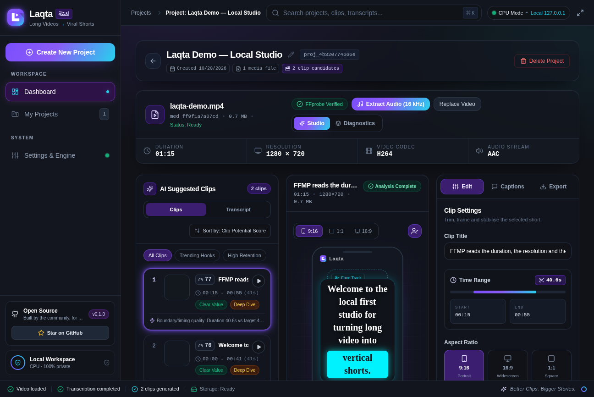
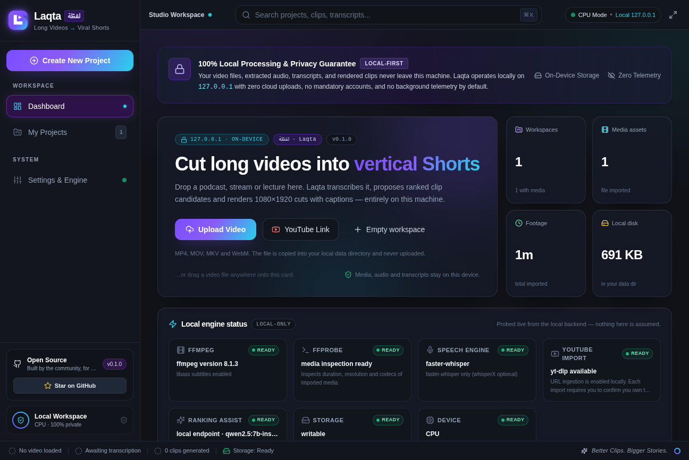
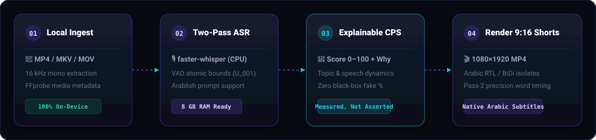
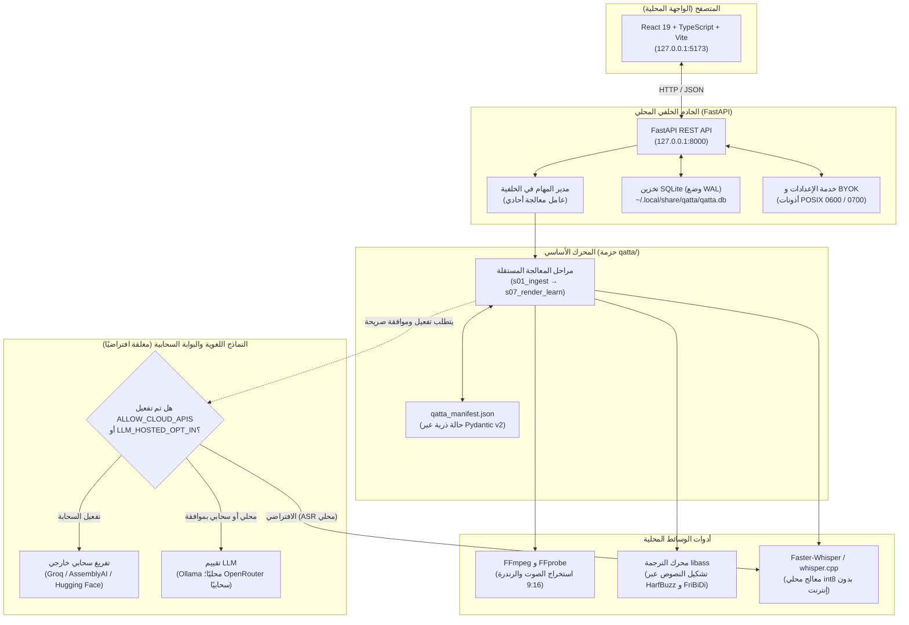

<div dir="rtl" align="right">

<div align="center">


# لقطة (Laqta)

### _من الفيديوهات الطويلة إلى مقاطع Shorts متميزة_

**استوديو مفتوح المصدر يعمل محليًا افتراضيًا بمساعدة الذكاء الاصطناعي لمساعدة صنّاع المحتوى في اكتشاف، وتحرير، وتصدير مقاطع الفيديو القصيرة العمودية من الفيديوهات الطويلة.**

[](https://dl.circleci.com/status-badge/redirect/gh/thewizard2030/laqta/tree/main)
[](https://github.com/thewizard2030/laqta/releases/latest)
[](LICENSE)
[](docs/POLICY.md)
[](README.ar.md)

[English](README.md) • [العربية](README.ar.md)

[نظرة عامة](#-نظرة-عامة) • [معرض الاستوديو](#-معرض-الاستوديو) • [الخصائص](#-مصفوفة-الخصائص-والإمكانات-v025) • [الخصوصية](#-سياسة-الخصوصية-والأمان-الشفافة) • [البدء السريع](#-البدء-السريع) • [سطر الأوامر](#-دليل-أوامر-سطر-الأوامر-cli) • [المعمارية](#-معمارية-النظام-ومكوناته) • [التوثيق](#-مركز-التوثيق-الفني)

</div>

---

## 💡 نظرة عامة

**لقطة (Laqta)** هو استوديو احترافي يُراعي الخصوصية تمامًا، مُصمم لتحويل مقاطع الفيديو الطويلة، والمقابلات، وبودكاست الصوت والفيديو إلى مقاطع قصيرة عمودية بنسبة 9:16 تلائم منصات YouTube Shorts و Instagram Reels و TikTok.

تتطلب معظم أدوات إعادة استخدام الفيديو رفع غيغابايت من وسائطك وفيديوهاتك الخاصة إلى خوادم سحابية خارجية، أو تقييد الخصائص الأساسية باشتراكات شهرية متكررة، أو توليد نصوص توضيحية عربية مقلوبة ومفككة الحروف. يُغير تطبيق "لقطة" هذه المعادلة بالكامل:

1. **يعمل محليًا افتراضيًا (Local-First):** تتم جميع مراحل معالجة الفيديو، واستخراج الصوت، والتفريغ الصوتي، ورندرة الفيديو محليًا بالكامل على عتاد جهازك الشخصي (`127.0.0.1`). لا يُطلب منك رفع ملفاتك إلى السحابة مطلقًا.
2. **معمارية ترتكز على المعالج المركزي (CPU-First):** مُصمم ليعمل بكفاءة على أجهزة 8 غيغابايت رام باستخدام Faster-Whisper (بنموذج `base` `int8` افتراضيًا في الاستوديو؛ كما يتيح محرك `qatta/` الأساسي تهيئة `QATTA_TURBO_MODEL` عند توفر ذاكرة أكبر) دون اشتراط كروت شاشة منفصلة.
3. **درجة إمكانات المقطع المُفسّرة (Clip Potential Score - CPS):** بدلاً من نسب "توقع الانتشار الفيروسي" الغامضة والوهمية، يُقيّم التطبيق اللحظات المرشحة بناءً على مقاييس صوتية ولغوية وإيقاعية حقيقية مع إيضاح أسباب ومعايير كل تقييم.
4. **دعم أصيل للغة العربية والكتابة ثنائية الاتجاه (BiDi):** معالجة دقيقة للنصوص المكتوبة من اليمين إلى اليسار (RTL) باستخدام علامات العزل الاتجاهي في يونيكود (FSI/PDI) مع توجيهات Whisper مخصصة للعبارات العربية الممزوجة بالإنجليزية (Arablish)، للحفاظ على المصطلحات التقنية اللاتينية دون تشويه اتجاه النص أو علامات الترقيم.
5. **استخدم مفاتيح API الخاصة بك (BYOK):** دعم متكامل لنقاط النهاية المحلية المتوافقة مع OpenAI (مثل Ollama و LM Studio و llama.cpp و vLLM) ومزودات الاستنتاج السحابية الاختيارية المغلقة افتراضيًا (OpenRouter لتقييم المقاطع، و Groq و AssemblyAI و Hugging Face للتفريغ السحابي) مع عزل صارم للمفاتيح محليًا.

---

## 📸 معرض الاستوديو

<div align="center">

### منصة عمل الاستوديو


_خط زمني تفاعلي متعدد المسارات، مشغل مقاطع عمودية 9:16 مع إرشادات المنطقة الآمنة للشاشات، محرر نصوص توضيحية تفاعلي (Karaoke)، واستعراض اللحظات المرشحة مع تفاصيل تقييمها._

<br/>

### لوحة التحكم ومراقبة قدرات النظام


_إدارة المشاريع، استيراد الوسائط محليًا، الفحص الحي لعتاد الجهاز ومكتبات الوسائط، ومتابعة حالات المعالجة المباشرة._

</div>

---

## 🔄 كيف يعمل النظام

يُعالج تطبيق "لقطة" الفيديوهات عبر مسار مراحل متتابع وقابل للاستئناف مسجّل في ملف بيان تركيبي موثوق (`qatta_manifest.json`):



1. **الاستيراد المحلي:** نسخ الفيديو بأمان إلى مجلد مشروعك المحلي (`~/.local/share/qatta`). لا يتم تعديل الملف الأصلي أو حذفه إطلاقًا.
2. **استخراج الصوت:** استخراج صوت نقي 16 كيلوهرتز أحادي القناة (Mono WAV) بسرعة فائقة عبر عمليات FFmpeg محلية آمنة.
3. **تفريغ صوتي على مرحلتين (Two-Pass ASR):**
   - **المرحلة الأولى (كامل الفيديو):** تفريغ سريع على مستوى الجمل والمقاطع عبر Faster-Whisper المحلي (أو سحابيًا/عبر نصوص YouTube اختياريًا بموافقة صريحة) دون حساب توقيت الكلمات الفردية لكامل الفيديو توفيرًا لقدرات المعالج.
   - **المرحلة الثانية (المقاطع المختارة):** حساب توقيت دقيق على مستوى الكلمة (بنموذج `small` `int8` افتراضيًا) عند الحاجة لتوليد الترجمة التفاعلية للمقاطع المختارة فقط.
4. **ترتيب واكتشاف اللحظات المهمة:** تحليل إيقاع الكلام وفواصل الصمت وديناميكيات الصوت لإسناد **درجة إمكانات المقطع (CPS)** مع تفسير واضح لأسباب الترشيح.
5. **التأطير العمودي (9:16):** تحويل الفيديوهات الأفقية إلى أبعاد 1080×1920 عبر القص المتمركز (`center_crop`) أو الخلفية المموّهة (`blurred_background`) أو التأطير الموجّه بالوجه (`face_guided`) مع طبقات المناطق الآمنة في مُصيّر الاستوديو. المرحلة الأساسية `qatta/stages/s06_reframe_subs` موصولة بخط المعالجة، وعند تفعيلها عبر `QATTA_FACE_GUIDED_FRAMING=true` (أو `{"face_guided_framing": true}` في مهمة خط المعالجة) تأخذ عيّنات من الإطارات وتحسب مسار قصّ لكل مشهد. مع تخطيط `face_guided` يحرّك المُصيّر نافذة 9:16 على طول هذا المسار. أما المقاطع التي لا تملك مسارًا محسوبًا — بما فيها كل المقاطع عندما لا تُفعّل الخيار — فتُصدَّر بقصّ متمركز، ويسجّل إعداد الرندرة سبب التراجع.
6. **حرق النصوص التوضيحية العربية (RTL):** حرق الترجمة المصممة داخل الفيديو عبر محرك `libass` مع تشكيل الحروف المتقدم عبر HarfBuzz و FriBiDi.

---

## ⚖️ ما الذي يُميز "لقطة" عن غيره؟

| المقارنة                    | لقطة (Laqta - مفتوح المصدر)                          | المنصات السحابية التجارية                      | السكريبتات التقليدية المفتوحة          |
| :-------------------------- | :--------------------------------------------------- | :--------------------------------------------- | :------------------------------------- |
| **خصوصية البيانات**         | **محلي 100% افتراضيًا**؛ لا تغادر فيديوهاتك جهازك    | رفع إلزامي للفيديوهات إلى خوادم سحابية للغير   | متفاوت؛ غالبًا ما يتطلب مفاتيح سحابية  |
| **ترخيص البرمجية**          | **ترخيص MIT**؛ مجاني ومفتوح المصدر بالكامل           | اشتراكات متكررة تبدأ من 19 إلى 49 دولار شهريًا | غالبًا تراخيص GPL/AGPL مشددة           |
| **النصوص العربية والـ RTL** | **دعم أصيل للـ BiDi وعوازل FSI/PDI**؛ نصوص سليمة     | حروف مقلوبة، خطوط مفككة، أو ترقيم معكوس        | ملفات SRT بسيطة دون تشكيل صحيح         |
| **تقييم المقاطع**           | **درجة CPS مُفسّرة (0–100)** مع معايير الاختيار      | نسب مئوية مبهمة تدّعي "توقع الفيروسية"         | تقطيع زمني عشوائي (مثل كل 30 ثانية)    |
| **متطلبات التشغيل**         | **معالج عادي (8 GB RAM)**؛ كارت الشاشة اختياري       | خوادم سحابية فقط                               | متطلبات VRAM ضخمة لكروت الشاشة (12GB+) |
| **تحكم المستخدم**           | **استوديو BYOK** لتخزين المفاتيح محليًا وفحصها       | انغلاق كامل على المزود التجاري                 | مفاتيح مشفرة يدويًا في ملفات البيئة    |
| **التتبع والتحليلات**       | **خالٍ من أي تتبع**؛ يرتبط محليًا فقط بـ `127.0.0.1` | تتبع سلوكي لسجلات وبيانات الاستخدام            | متفاوت                                 |

> **تنبيه حول درجة إمكانات المقطع (CPS):** تمثل درجة CPS أداة مساعدة تحريرية تستند إلى التغيرات الصوتية، ومعدل الإلقاء، واكتمال المعنى. إنها مُصممة لمساعدة المونتير وصانع المحتوى في العثور السريع على اللقطات القوية، وليست ضمانًا لتحقيق ملايين المشاهدات أو تفاعل مؤكد.

---

## 🧩 مصفوفة الخصائص والإمكانات (v0.4.0)

### 🎬 مسار الفيديو والتحرير

- **الاستيراد المحلي:** سحب وإفلات الفيديوهات بصيغ MP4 و MOV و MKV و WebM. `[مدعوم بالكامل]`
- **مساحات المشاريع:** حفظ دائم للمشاريع في قاعدة بيانات SQLite محلية في `~/.local/share/qatta/`. `[مدعوم بالكامل]`
- **خط زمني متعدد المسارات:** معاينة المخطط الصوتي، والتحكم في التشغيل، وقص أطراف المقطع. `[مدعوم بالكامل]`
- **التأطير العمودي (9:16):** أبعاد 1080×1920 عبر القص المتمركز (`center_crop`) أو الخلفية المموّهة (`blurred_background`) أو التأطير الموجّه بالوجه (`face_guided`) مع إرشادات المناطق الآمنة (`[مدعوم بالكامل]`). يتطلّب `face_guided` مسار قصّ محسوبًا، أي تفعيل المحلّل عبر `QATTA_FACE_GUIDED_FRAMING=true` أو علم مهمة خط المعالجة، وهو يرى الوجوه الأمامية فقط (`[اختياري]`). وبدون مسار، يتمركز القصّ ويُسجَّل سبب التراجع في إعداد الرندرة.
- **تصدير عالي الجودة:** معالجة محلية عبر FFmpeg بحرق نصوص ASS أو تصدير ملفات SRT منفصلة. `[مدعوم بالكامل]`
- **استيراد الروابط الخارجية:** استيراد تفريغ YouTube أولاً عبر `yt-dlp` (مغلق افتراضيًا ويتطلب تفعيل المشغل وتأكيد حقوق المادة). `[اختياري ومغلق افتراضيًا]`

### 🎙️ الذكاء الاصطناعي والتفريغ الصوتي

- **Faster-Whisper محلي:** تفريغ صوتي فائق السرعة عبر CTranslate2 بدون إنترنت. `[مدعوم بالكامل]`
- **ثلاثة أنماط للأداء:**
  - `fast` (الافتراضي): نموذج `base` مع ترميز `int8` وعرض حزمة 1 (مستوى الجمل؛ مع محاذاة الكلمات للمقطع المختار عند الحاجة). مناسب لأجهزة 8 غيغابايت.
  - `balanced`: نموذج `small` مع ترميز `int8` وعرض حزمة 1 لدقة أعلى في اللهجات العربية (~ضعف زمن المعالجة مقارنة بـ `base`).
  - `accurate`: نموذج `medium` مع ترميز `int8` وعرض حزمة 1 ومحاذاة الكلمات لكامل الفيديو (أبطأ بشكل ملحوظ على المعالج).
- **توجيه عربي/إنجليزي (Arablish):** تهيئة أولية تحافظ على كتابة المصطلحات البرمجية والتقنية باللاتينية دون تشويه الجملة العربية. `[مدعوم بالكامل]`
- **تفريغ محلي / سحابي اختياري:** دعم اختياري لـ `whisper.cpp` محليًا `[اختياري محلي]`، وتفريغ سحابي مغلق افتراضيًا عبر Groq Cloud Whisper أو AssemblyAI أو Hugging Face Inference API `[اختياري ومغلق افتراضيًا]`.
- **نماذج لغوية متوافقة مع OpenAI وسحابية:** الاتصال بخوادم الاستنتاج المحلية (Ollama و LM Studio و llama.cpp و vLLM) أو مزود OpenRouter السحابي (`LLM_HOSTED_OPT_IN=true`) للمساعدة في تقييم المقاطع. `[اختياري ومغلق افتراضيًا]`

### 🔐 الخصوصية، الأمان وإدارة المفاتيح (BYOK)

- **ضمان العمل المحلي:** لا توجد أي أدوات تتبع (Telemetry)، أو اتصالات خلفية، أو خوادم قياس عن بعد. `[مدعوم بالكامل]`
- **استوديو مفاتيحك الخاصة (BYOK):** واجهة مخصصة من 5 علامات تبويب لإدارة الإعدادات والمفاتيح. `[مدعوم بالكامل]`
- **حماية الأذونات على القرص:** فرض أذونات POSIX صارمة: المجلدات بـ `0700` والملفات بـ `0600` (`-rw-------`). `[مدعوم بالكامل]`
- **حجب وتشفير عرض المفاتيح في الـ API:** حجب المفاتيح السرية في الاستجابات (مثل `sk-or-...a1b2`) وعدم تسجيلها في ملفات السجل مطلقًا. `[مدعوم بالكامل]`
- **الحماية ضد هجمات SSRF:** منع الاتصال بالعناوين المحجوزة أو شبكات الحوسبة السحابية الداخلية (`169.254.169.254`). `[مدعوم بالكامل]`

### 🐧 دعم بيئة لينكس وتكامل النظام

- **دعم رئيسي لبيئة فيدورا ولينكس:** تم اختباره والتأكد من توافقه الكامل مع Fedora ومختلف توزيعات Linux. `[مدعوم بالكامل]`
- **فحص جاهزية النظام (`laqta doctor`):** أداة سطر أوامر مدمجة للتحقق من Python و FFmpeg و FFprobe وأذونات التخزين. `[مدعوم بالكامل]`
- **اختصار سطح المكتب XDG:** ملف تشغيل لسطح المكتب (`packaging/laqta.desktop`) وأيقونات قياسية تُثبت عبر `./packaging/install.sh --user`. `[مدعوم بالكامل]`

---

## 🔒 سياسة الخصوصية والأمان الشفافة

> **المبدأ الأساسي المُلزم:** يعمل تطبيق "لقطة" محليًا افتراضيًا. تظل كافة وسائطك وعمليات التفريغ الصوتي على حاسوبك الشخصي. لا تستقبل المزودات السحابية الاختيارية سوى النص أو الصوت المحدد والمطلوب لتلك العملية فقط، وذلك عندما يقوم المستخدم بتفعيل صلاحيات الاتصال السحابي والموافقة عليها صراحة.

للاطلاع على التزامات الأمان والسياسات بالتفصيل:

- [docs/POLICY.md](docs/POLICY.md) — ما الذي يغادر جهازك، ومتى، ومسؤوليات حقوق الاستيراد.
- [docs/BYOK_DESIGN.md](docs/BYOK_DESIGN.md) — مواصفات أمان المفاتيح ونموذج التهديدات المحتملة.
- [SECURITY.md](SECURITY.md) — إرشادات الإبلاغ الآمن عن الثغرات الأمنية وقنوات التواصل الخاصة.

### إفصاح شفاف حول تخزين المفاتيح محليًا

في الإصدار v0.2.5، يتم حفظ المفاتيح والإعدادات التي يُدخلها المستخدم محليًا في قاعدة بيانات SQLite (`~/.local/share/qatta/qatta.db`) وملف JSON تكميلي (`settings.json`). **يتم حفظ هذه البيانات محليًا غير مشفرة أثناء السكون (Unencrypted at Rest)** مع حمايتها بأذونات المستخدم المحددة لنظام الملفات (`0600` للملفات، و`0700` للمجلدات). إذا كنت تتشارك حساب المستخدم ذاته مع آخرين على نفس الجهاز، يُفضل عدم حفظ مفاتيح API إنتاجية حساسة.

---

## 🚀 البدء السريع

### متطلبات النظام الأساسية

| المكون      | الحد الأدنى / البيئة المعتمدة                                                       |
| :---------- | :---------------------------------------------------------------------------------- |
| **النظام**  | Linux (Fedora / RHEL أو Ubuntu / Debian)                                            |
| **Python**  | `>= 3.11` (يُوصى بإصدار `3.11` أو `3.12`)                                           |
| **Node.js** | `>= 22.12` + `npm` (مطلوب في `frontend/package.json` لحزم Vite 8 و Vitest 5)        |
| **الوسائط** | `ffmpeg` (مبني مع `libass` و HarfBuzz و FriBiDi) و `ffprobe`                        |
| **الذاكرة** | 8 جيجابايت رام (معالجة أولية بالمعالج `int8`؛ تُحمّل أوزان Whisper عند أول استخدام) |

### الطريقة الأولى: التثبيت المحلي المباشر (موصى به لفيدورا ولينكس)

#### 1. تثبيت حزم النظام المطلوبة

**على Fedora / RHEL:**

```bash
sudo dnf install -y ffmpeg libass python3 python3-devel nodejs npm
```

**على Ubuntu / Debian:**

```bash
sudo apt update && sudo apt install -y ffmpeg libass-dev python3 python3-venv
```

> **ملاحظة حول Node.js `>= 22.12` على Ubuntu / Debian:** غالبًا ما توفر مستودعات `apt` في التوزيعات الأقدم إصدارات أقدم من Node.js. ثبّت Node.js `22.x` عبر [nvm](https://github.com/nvm-sh/nvm) أو [fnm](https://github.com/Schniz/fnm) أو NodeSource إذا كان ناتج `node -v` أقل من `v22.12`.

#### 2. استنساخ المشروع والإعداد الآلي

```bash
# استنساخ المستودع
git clone https://github.com/thewizard2030/laqta.git
cd laqta

# إنشاء البيئة الافتراضية backend/.venv (النواة + API + ASR محلي) وتثبيت حزم الواجهة
./scripts/setup.sh
# خيارات إضافية: --all (لتثبيت yt-dlp وحزم [analysis]) | --api-only | --no-frontend
```

#### 3. التحقق من جاهزية العتاد

نشّط البيئة الافتراضية أولاً (أو نفّذ `./backend/.venv/bin/laqta` مباشرة) ثم شغّل أداة الفحص:

```bash
source backend/.venv/bin/activate
laqta doctor
```

```text
Laqta doctor — local environment check

✓   Python          3.11.x           >= 3.11 required
✓   FFmpeg          8.x              /usr/bin/ffmpeg
✓   FFprobe         8.x              /usr/bin/ffprobe
✓   Local ASR       faster-whisper   Speech recognition on this CPU
!   URL import      disabled by ...  Disabled by default (QATTA_ENABLE_URL_INGESTION=false)
✓   Data directory  writable         ~/.local/share/qatta
✓   Hosted ranker   disabled         Local heuristic scoring is used — nothing is uploaded
✓   Disk space      ...              available on the data volume
```

#### 4. تشغيل الاستوديو

للتشغيل في وضع التطوير (مع التحديث التلقائي للكود):

```bash
./scripts/dev.sh
```

- **واجهة برمجة التطبيقات (API):** `http://127.0.0.1:8000` (توثيق Swagger على `/docs`)
- **واجهة استوديو لقطة:** `http://127.0.0.1:5173`

للتشغيل في وضع الإنتاج المدمج (من داخل البيئة الافتراضية `backend/.venv`، يبني الواجهة ويخدمها مباشرة عبر FastAPI على عنوان واحد):

```bash
source backend/.venv/bin/activate
laqta studio --production
```

- افتح المتصفح مباشرة على: `http://127.0.0.1:8000`.

تثبيت اختصار قائمة تطبيقات لينكس (اختياري):

```bash
./packaging/install.sh --user   # يثبت ~/.local/share/applications/laqta.desktop والأيقونات
```

---

### الطريقة الثانية: التشغيل عبر Docker Compose (معاينة تجريبية)

> [!NOTE]
> التثبيت المحلي من المصدر (الطريقة الأولى) هو المسار الأساسي المختبر لإصدار `v0.4.0`. راجع [Dockerfile](Dockerfile) و[docker-compose.yml](docker-compose.yml) قبل الاعتماد على الحاويات (حيث يثبّت `Dockerfile` الحزمة الأساسية `.[asr]` فقط دون `backend/requirements.txt` ويستخدم `QATTA_BIND_HOST`/`QATTA_BIND_PORT` بدلاً من `QATTA_HOST`/`QATTA_PORT`).

```bash
git clone https://github.com/thewizard2030/laqta.git
cd laqta
docker compose up
```

بعد اكتمال التشغيل، افتح المتصفح على: **`http://127.0.0.1:8000`**.

---

## ⌨️ دليل أوامر سطر الأوامر (CLI)

نفّذ الأوامر بعد تفعيل `source backend/.venv/bin/activate` (أو عبر المسار المباشر `./backend/.venv/bin/`):

| الأمر                   | الوصف                                                                                                |
| :---------------------- | :--------------------------------------------------------------------------------------------------- |
| `laqta --version`       | عرض رقم الإصدار المثبّت (`0.4.0`).                                                                   |
| `laqta doctor [--json]` | فحص Python و FFmpeg/FFprobe ومحرّك التفريغ وحالة استيراد الروابط وأذونات التخزين والخوادم.           |
| `laqta run SOURCE`      | تشغيل خط المعالجة كاملاً بدون واجهة: `--project-id`، `--work-dir`، `--stages`، `--force`، `--json`. |
| `laqta models`          | استعراض نماذج الصوت المخزنة محليًا في ذاكرة Hugging Face وحجمها على القرص.                           |
| `laqta serve`           | تشغيل خادم FastAPI المحلي (`--host 127.0.0.1 --port 8000 [--reload]`).                               |
| `laqta studio`          | تشغيل الخادم الخلفي والواجهة معًا (`--production`، `--api-only`، `--frontend-only`، `--skip-build`). |

---

## 🧪 التطوير والتحقق من الجودة

```bash
./scripts/check.sh --fast                 # فحوصات Ruff وتزامن الإصدارات واختبارات الباك-إند والنواة والواجهة
pytest tests --tb=short                   # اختبارات النواة الأساسية qatta/
cd backend && .venv/bin/pytest tests -n auto && cd ..   # اختبارات FastAPI الخلفية
cd frontend && npm run check && cd ..     # فحص TypeScript و ESLint و Prettier و Vitest
```

---

## 🛠️ استكشاف الأخطاء وحلولها

<details>
<summary><b>1. خطأ <code>laqta: command not found</code> أو <code>ModuleNotFoundError: No module named 'uvicorn'</code></b></summary>

يقوم `./scripts/setup.sh` بتثبيت أداة `laqta` وحزم الخادم الخلفي داخل `backend/.venv` وليس في بيئة النظام العامة. نشّط البيئة الافتراضية أولاً (أو استخدم `./backend/.venv/bin/laqta`):

```bash
source backend/.venv/bin/activate
```

</details>

<details>
<summary><b>2. عدم دعم FFmpeg لمكتبة <code>libass</code></b></summary>

يتطلب حرق النصوص والترجمة العربية داخل الفيديو دعم FFmpeg لمكتبة `libass`. على نظام Fedora، تأكد من تثبيت الحزم من مستودعات RPM Fusion. ويمكنك التأكد من تفعيل المكتبة عبر تشغيل:

```bash
ffmpeg -version | grep -- --enable-libass
```

</details>

<details>
<summary><b>3. المنفذ 8000 أو 5173 مستخدم بالفعل</b></summary>

يغيّر متغير البيئة `QATTA_PORT` منفذ **الخادم الخلفي (FastAPI)** في `./scripts/dev.sh` (كما يلتزم به `laqta doctor`)، بينما يظل خادم تطوير Vite على `127.0.0.1:5173` ويوجه طلبات `/api` إلى `http://127.0.0.1:8000` (وفق `frontend/vite.config.ts`). لتشغيل الاستوديو بالكامل على منفذ بديل واحد:

```bash
# وضع الإنتاج المدمج على منفذ بديل (بدون خادم تطوير Vite):
./backend/.venv/bin/laqta studio --production --port 8080

# تشغيل الخادم الخلفي فقط في وضع التطوير على منفذ آخر:
QATTA_PORT=8080 ./scripts/dev.sh
```

</details>

---

## 🏛️ معمارية النظام ومكوناته

<div dir="ltr" align="center">



</div>

### تقسيم الأنظمة الفرعية

- **`qatta/`**: محرك خط الإنتاج الأساسي المعتمد على ملف البيان التركيبي. مستقل تمامًا عن أطر الويب، مبني بـ Pydantic v2، ومرخص بـ MIT.
- **`backend/`**: خدمة FastAPI المحلية (`backend/app/main.py`)، ومستودع SQLite، ومدير مهام الخلفية، وواجهة برمجة الإعدادات.
- **`frontend/`**: واجهة الاستوديو التفاعلية المبنية بـ React 19 و Vite، وتضم الخط الزمني، ومشغل 9:16، ومحرر النصوص، واستوديو الإعدادات.
- **`scripts/`**: سكريبتات أتمتة التطوير (`dev.sh` و `setup.sh`)، وفحوصات الـ CI، والتحقق من الإصدارات ونشرها (`publish_github_release.py`)، واختبارات تقييم جودة المقاطع.
- **`.circleci/`**: منصة الـ CI/CD ونشر الإصدارات الرئيسية المعتمدة (`ci` للفروع وطلبات الدمج، و`release` عند الوسوم مع سياق `laqta-release-publishing` المعزول)، بينما تقتصر مسارات GitHub Actions على التشغيل اليدوي `workflow_dispatch`. اجتازت الإصدارات [`v0.2.5`](https://github.com/thewizard2030/laqta/releases/tag/v0.2.5) و[`v0.3.0`](https://github.com/thewizard2030/laqta/releases/tag/v0.3.0) و[`v0.3.1`](https://github.com/thewizard2030/laqta/releases/tag/v0.3.1) فحوصات ونشر CircleCI (`backend` و`frontend` و`publish-release` عبر مسارات العمل [`1a3a76df`](https://app.circleci.com/workflow/1a3a76df-da76-472a-a5f4-8a5631483787) و[`3d0f2617`](https://app.circleci.com/workflow/3d0f2617-08eb-499e-b906-36a6b9cee815) و[`913c44df`](https://app.circleci.com/workflow/913c44df-32db-42c4-9fac-a5e990a2df86)). الإصدار [`v0.4.0`](https://github.com/thewizard2030/laqta/releases/tag/v0.4.0) منشور، لكن مسار `release` في CircleCI **فاشل**: أُوقفت مهمة `backend` في منتصف مجموعة الاختبارات دون أي اختبار فاشل، ورفض CircleCI إعادة تشغيلها، لذا بُني الملف من الوسم غير القابل للتغيير وتحقّق منه بشكل مستقل — راجع [`docs/RELEASING.md`](docs/RELEASING.md).
- **`docs/`**: مركز التوثيق الفني، والمواصفات المعمارية، ودليل السياسات والعلامة التجارية.

---

## 📚 مركز التوثيق الفني

للاطلاع على تفاصيل المعمارية الهندسية، ونتائج القياسات المعيارية، وإرشادات المساهمة، تفضل بزيارة **[مركز توثيق لقطة](docs/README.md)**:

| الوثيقة                                                          | الوصف والمحتوى                                                                     |
| :--------------------------------------------------------------- | :--------------------------------------------------------------------------------- |
| **[CHANGELOG.md](CHANGELOG.md)**                                 | سجل التغييرات الكامل متضمنًا **`v0.2.5`** والإصلاحات والقيود المعروفة              |
| **[docs/RELEASING.md](docs/RELEASING.md)**                       | خطوات النشر التلقائي عبر CircleCI والتحقق بـ SHA-256 وسجلات الإصدارات المكتملة     |
| **[docs/CIRCLECI_MIGRATION.md](docs/CIRCLECI_MIGRATION.md)**     | بنية CircleCI 2.1 وعزل سياق `laqta-release-publishing` وتفاصيل الانتقال من Actions |
| **[docs/LICENSING.md](docs/LICENSING.md)**                       | سياسة ترخيص MIT الدائمة وفصل حزم الطرف الثالث وحقوق العلامة التجارية               |
| **[docs/ARCHITECTURE.md](docs/ARCHITECTURE.md)**                 | شرح تفصيلي لدورة حياة ملف البيان، ومزامنة المراحل، وحدود العمليات                  |
| **[docs/POLICY.md](docs/POLICY.md)**                             | ميثاق الخصوصية المفتوح، وسياسات التتبع، وتراخيص النماذج المستخدمة                  |
| **[docs/BYOK_DESIGN.md](docs/BYOK_DESIGN.md)**                   | مواصفات ميزة استخدام مفاتيحك الخاصة (BYOK) ونموذج حماية التهديدات                  |
| **[docs/EVALUATION.md](docs/EVALUATION.md)**                     | القياسات المعيارية لجودة ودقة ترشيح المقاطع (Precision و Recall و F1)              |
| **[docs/PERFORMANCE.md](docs/PERFORMANCE.md)**                   | أنماط التفريغ الصوتي، وقياسات استهلاك الذاكرة في حدود 8 جيجابايت رام               |
| **[docs/CAPTION_QA.md](docs/CAPTION_QA.md)**                     | التحقق من محاذاة النصوص العربية BiDi وعوازل FSI/PDI وجودة الحرق عبر `libass`       |
| **[docs/UPGRADING.md](docs/UPGRADING.md)**                       | مسارات الترقية بين الإصدارات وتوافقية قاعدة البيانات والإعدادات                    |
| **[docs/BRANDING.md](docs/BRANDING.md)**                         | دليل الهوية البصرية، ورموز الألوان، وضوابط استخدام أصول العلامة التجارية           |
| **[THIRD_PARTY_NOTICES.md](THIRD_PARTY_NOTICES.md)**             | تراخيص وإشعارات حقوق النشر لمكتبات الطرف الثالث المباشرة وحزم التشغيل              |
| **[docs/RELEASE_NOTES_v0.2.0.md](docs/RELEASE_NOTES_v0.2.0.md)** | ملاحظات الإصدار السابق `v0.2.0` (استوديو الإعدادات وإدارة المفاتيح BYOK)           |

---

## 🤝 المساهمة والتطوير المجتمعي

نرحب بكافة المساهمات من المطورين، والمصممين، وصنّاع المحتوى!

- **الإبلاغ عن المشكلات واقتراح الخصائص:** تفضل بفتح تذكرة عبر **[GitHub Issues](https://github.com/thewizard2030/laqta/issues)**.
- **إرشادات المساهمة البرمجية:** يُرجى قراءة **[CONTRIBUTING.md](CONTRIBUTING.md)** للتعرف على إعداد البيئة البرمجية، ومعايير الكود، وطريقة إرسال التعديلات.
- **ميثاق السلوك:** يلتزم مجتمعنا بما جاء في **[CODE_OF_CONDUCT.md](CODE_OF_CONDUCT.md)**.
- **الإبلاغ عن الثغرات الأمنية:** نرجو الإبلاغ عن أي ملاحظات أمنية بشكل سري وخاص عبر [GitHub Security Advisories](https://github.com/thewizard2030/laqta/security/advisories/new) أو باتباع التعليمات الواردة في **[SECURITY.md](SECURITY.md)**.

---

## 📈 سجل الإعجابات (Star History)

[](https://star-history.com/#thewizard2030/laqta&Date)

---

## 📄 الترخيص

تطبيق "لقطة" هو برمجية حرة مفتوحة المصدر مرخصة بموجب **[ترخيص MIT](LICENSE)**.
جميع الحقوق محفوظة © 2026 محمد أبوالعلا والمساهمين في مشروع لقطة.

تراخيص المكتبات الخارجية ومكونات بيئة التشغيل مفصلة في وثيقة [THIRD_PARTY_NOTICES.md](THIRD_PARTY_NOTICES.md).

</div>
