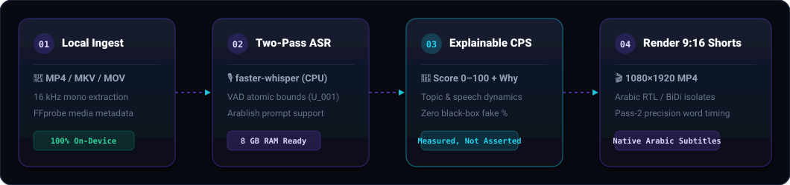

<div dir="rtl" align="right">

<div align="center">


### **حوّل الفيديوهات الطويلة والبودكاست إلى مقاطع Shorts عمودية ذكية — بالكامل على جهازك الشخصي.**

[](README.md)
[](LICENSE)
[](docs/POLICY.md)
[](README.ar.md)

</div>

---

**لقطّة (Laqta)** هو استوديو مفتوح المصدر يعمل محلياً بالكامل لتحويل الفيديوهات الطويلة ومقابلات البودكاست إلى مقاطع قصيرة عمودية مقاس 1080×1920 (Shorts و Reels و TikTok)، مع تفريغ صوتي دقيق، وترتيب ذكي مفسّر لأفضل اللقطات، وتوليد نصوص توضيحية (Captions) تدعم اللغة العربية من اليمين لليسار بطريقة صحيحة تماماً.

> **بدون حساب. بدون رفع ملفات. بدون تتبع.** ملفاتك وفيديوهاتك لا تغادر جهازك إطلاقاً، والأداة تعمل بنسبة 100% بدون أي مفاتيح API مدفوعة.



---

## 💡 لماذا لقطّة؟

| الميزة | التفاصيل |
| :--- | :--- |
| 🌍 **دعم عربي أصيل** | تصميم خاص لاتجاه النص من اليمين لليسار (RTL)، معالجة النصوص المختلطة عربية/إنجليزية (Arablish)، وضبط اتجاه علامات الترقيم والأقواس وعزل الحروف (FSI/PDI) بدون أي تشويه. |
| 🔒 **محلي بالكامل (خصوصية تامة)** | معالجة الصوت، التفريغ، واقتصاص الفيديو تتم جميعها على جهازك. خادم الواجهة يرتبط محلياً فقط بـ `127.0.0.1` بدون أي تتبع خارجي. |
| 🧠 **تقييم ذكي ومُفسّر (CPS)** | كل مقطع مقترح يحصل على درجة إمكانية (Clip Potential Score من 0 إلى 100) مصحوبة **بالأسباب الحقيقية لاختياره** بناءً على نبرة الصوت والموضوع وسرعة الإلقاء، دون أرقام وهمية أو ادعاءات انتشار غير حقيقية. |
| 🪶 **يعمل على الأجهزة العادية** | مصمم ليعمل بكفاءة على معالجات عادية وذاكرة **8 جيجابايت رام** بدون الحاجة لبطاقات رسومية خارقة، بفضل تقنية التفريغ الصوتي على مرحلتين (Two-Pass Whisper). |
| ⚡ **حرية تامة ومجاني** | مرخص بترخيص MIT المفتوح، وبدون أي اشتراكات شهرية أو قيود على عدد الفيديوهات أو مدتها. |

---

## ⚖️ مقارنة: لقطّة مقابل الخدمات السحابية المدفوعة

| الخاصية | **لقطّة (Laqta)** | **Opus Clip / Submagic / Klap** | الأدوات مفتوحة المصدر التقليدية |
| :--- | :--- | :--- | :--- |
| **التكلفة** | **مجاني تماماً (MIT)** | \$19 إلى \$49 شهرياً | مجاني |
| **الخصوصية وأمان البيانات** | **100% محلي** (الملفات لا تخرج من حاسوبك) | يتم رفع الفيديوهات وتخزينها سحابياً | متفاوت |
| **دعم العربية وعكس النصوص** | **دعم متكامل للنصوص العربية والـ BiDi** | نصوص مقلوبة، وأقواس معكوسة في كثير من الأحيان | ضعيف أو غير موجود |
| **تقييم المقاطع** | **مُفسّر وقابل للقياس** (مع الأسباب) | نسبة مئوية غامضة (Black Box) | فترات زمنية عشوائية |
| **متطلبات التشغيل** | معالج عادي و **8 GB رام** | سحابي فقط | يتطلب عادة بطاقة GPU قوية |
| **التحكم وحرية التعديل** | استوديو كامل + واجهة برمجة وأوامر CLI | مقيد بواجهة المنصة السحابية | في الغالب أوامر سطرية فقط |

---

## 🚀 البدء السريع

### الخيار الأول: التشغيل بضغطة زر عبر Docker (موصى به)

إذا كان لديك Docker مثبت على جهازك، يمكنك تشغيل لقطّة مباشرة دون تثبيت Python أو Node:

```bash
git clone https://github.com/thewizard2030/laqta.git
cd laqta
docker compose up
```

ثم افتح المتصفح مباشرة على: **<http://localhost:8000>**

---

### الخيار الثاني: التثبيت المحلي

#### المتطلبات الأساسية
* **Python**: إصدار 3.11 أو 3.12
* **Node.js**: إصدار 22.12 أو أحدث
* **FFmpeg**: مع مكتبة `libass` (لحرق النصوص التوضيحية داخل الفيديو)

#### خطوات التثبيت:

```bash
# 1. استنساخ المستودع
git clone https://github.com/thewizard2030/laqta.git
cd laqta

# 2. تشغيل سكريبت الإعداد الآلي
./scripts/setup.sh

# 3. إطلاق الاستوديو بأمر واحد
laqta studio --production
```

سيقوم التطبيق ببناء الواجهة وتشغيل الخادم على العنوان: **<http://127.0.0.1:8000>**.

---

## 🩺 فحص جاهزية جهازك (Doctor CLI)

يوفر لك التطبيق أداة ذكية لفحص كل ما يحتاجه جهازك:

```bash
laqta doctor
```

ستظهر لك نتائج فحص دقيقة وشفافة:
```text
✓   Python          3.11.x            >= 3.11 متوفر
✓   FFmpeg          متوفر             يدعم حرق النصوص التوضيحية libass
✓   FFprobe         متوفر             لفحص ترميز وأبعاد الوسائط
✓   Local ASR       faster-whisper    تفريغ صوتي محلي على المعالج
✓   Data directory  جاهز للكتابة       ~/.local/share/qatta
```

---

## 💻 استوديو العمل التفاعلي

يوفر لقطّة استوديو متكامل يضم:
* سحب وإفلات الفيديوهات المحلية بسهولة.
* خط زمني (Timeline) تفاعلي لمعاينة الأصوات والحوارات بدقة.
* محرر تفاعلي لضبط وتعديل النصوص التوضيحية المحروقة.
* قوالب إطارات ذكية تتناسب مع شاشات الهواتف (9:16).
* تصدير فوري لملف فيديو MP4 وملفات الترجمة (SRT / ASS).


---

## 🤝 المساهمة والتطوير

نرحب بجميع المساهمين من المطورين وصناع المحتوى!
* لقراءة إرشادات المساهمة: راجع [CONTRIBUTING.md](CONTRIBUTING.md).
* للمناقشات وطرح الأفكار الجديدة: توجه إلى [GitHub Discussions](https://github.com/thewizard2030/laqta/discussions).
* للإبلاغ عن مشكلة: افتح [Issue جديد](https://github.com/thewizard2030/laqta/issues).

---

## 📄 الترخيص

مشروع لقطّة مرخص بموجب ترخيص **[MIT](LICENSE)** — حر ومفتوح المصدر بالكامل © 2026 محمد أبوالعلا والمساهمين في لقطّة.

</div>
