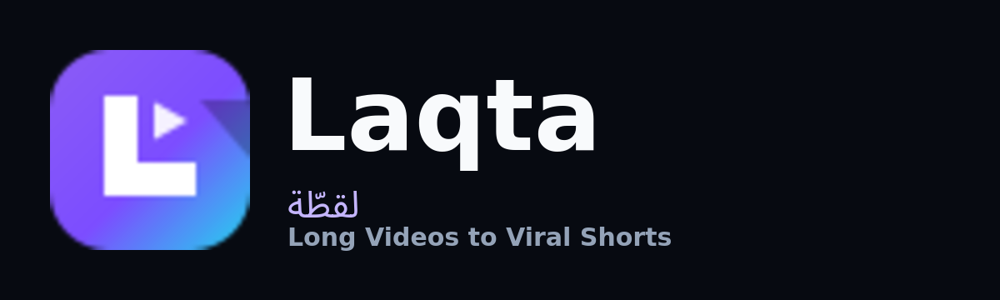
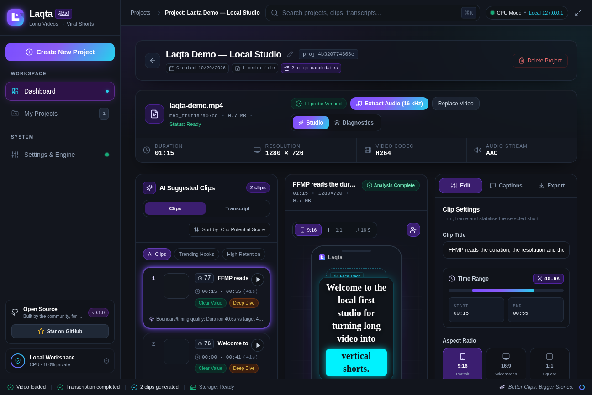
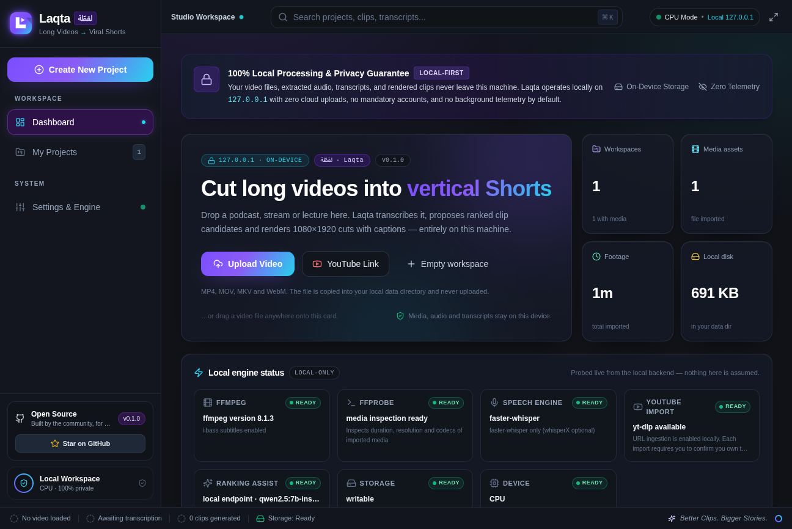
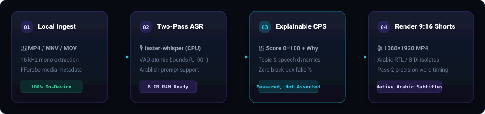

<div dir="rtl" align="right">

<div align="center">



# لقطة (Laqta)
### *من الفيديوهات الطويلة إلى مقاطع Shorts متميزة*

**استوديو مفتوح المصدر يعمل محليًا افتراضيًا بمساعدة الذكاء الاصطناعي لمساعدة صنّاع المحتوى في اكتشاف، وتحرير، وتصدير مقاطع الفيديو القصيرة العمودية من الفيديوهات الطويلة.**

[](https://app.circleci.com/pipelines/github/thewizard2030/laqta)
[](https://github.com/thewizard2030/laqta/releases/latest)
[](LICENSE)
[](docs/POLICY.md)
[](README.ar.md)

[English](README.md) • [العربية](README.ar.md)

</div>

---

## 💡 نظرة عامة

**لقطة (Laqta)** هو استوديو احترافي يُراعي الخصوصية تمامًا، مُصمم لتحويل مقاطع الفيديو الطويلة، والمقابلات، وبودكاست الصوت والفيديو إلى مقاطع قصيرة عمودية بنسبة 9:16 تلائم منصات YouTube Shorts و Instagram Reels و TikTok.

تتطلب معظم أدوات إعادة استخدام الفيديو رفع غيغابايت من وسائطك وفيديوهاتك الخاصة إلى خوادم سحابية خارجية، أو تقييد الخصائص الأساسية باشتراكات شهرية متكررة، أو توليد نصوص توضيحية عربية مقلوبة ومفككة الحروف. يُغير تطبيق "لقطة" هذه المعادلة بالكامل:

1. **يعمل محليًا افتراضيًا (Local-First):** تتم جميع مراحل معالجة الفيديو، واستخراج الصوت، والتفريغ الصوتي، ورندرة الفيديو محليًا بالكامل على عتاد جهازك الشخصي (`127.0.0.1`). لا يُطلب منك رفع ملفاتك إلى السحابة مطلقًا.
2. **معمارية ترتكز على المعالج المركزي (CPU-First):** مُصمم خصيصًا ليعمل بكفاءة على الأجهزة العادية بذاكرة 8 غيغابايت رام باستخدام نماذج Faster-Whisper خفيفة (بترميز `int8`) دون اشتراط بطاقات رسومية (GPU) خارجية مرتفعة التكلفة.
3. **درجة إمكانات المقطع المُفسّرة (Clip Potential Score - CPS):** بدلاً من نسب "توقع الانتشار الفيروسي" الغامضة والوهمية، يُقيّم التطبيق اللحظات المرشحة بناءً على مقاييس صوتية ولغوية وإيقاعية حقيقية مع إيضاح أسباب ومعايير كل تقييم.
4. **دعم أصيل للغة العربية والكتابة ثنائية الاتجاه (BiDi):** معالجة دقيقة للنصوص المكتوبة من اليمين إلى اليسار (RTL) باستخدام علامات العزل الاتجاهي في يونيكود (FSI/PDI) مع توجيهات Whisper مخصصة للعبارات العربية الممزوجة بالإنجليزية (Arablish)، للحفاظ على المصطلحات التقنية اللاتينية دون تشويه اتجاه النص أو علامات الترقيم.
5. **استخدم مفاتيح API الخاصة بك (BYOK):** دعم اختياري متكامل للمزودين السحابيين (OpenRouter و Groq و AssemblyAI و Hugging Face) ونقاط النهاية المحلية المتوافقة مع معايير OpenAI (مثل Ollama و LM Studio) مع عزل صارم للمفاتيح محليًا.

---

## 📸 معرض الاستوديو

<div align="center">

### منصة عمل الاستوديو

*خط زمني تفاعلي متعدد المسارات، مشغل مقاطع عمودية 9:16 مع إرشادات المنطقة الآمنة للشاشات، محرر نصوص توضيحية تفاعلي (Karaoke)، واستعراض اللحظات المرشحة مع تفاصيل تقييمها.*

<br/>

### لوحة التحكم ومراقبة قدرات النظام

*إدارة المشاريع، استيراد الوسائط محليًا، الفحص الحي لعتاد الجهاز ومكتبات الوسائط، ومتابعة حالات المعالجة المباشرة.*

</div>

---

## 🔄 كيف يعمل النظام

يُعالج تطبيق "لقطة" الفيديوهات عبر مسار مراحل متتابع وقابل للاستئناف مسجّل في ملف بيان تركيبي موثوق (`qatta_manifest.json`):



1. **الاستيراد المحلي:** نسخ الفيديو بأمان إلى مجلد مشروعك المحلي (`~/.local/share/qatta`). لا يتم تعديل الملف الأصلي أو حذفه إطلاقًا.
2. **استخراج الصوت:** استخراج صوت نقي 16 كيلوهرتز أحادي القناة (Mono WAV) بسرعة فائقة عبر عمليات FFmpeg محلية آمنة.
3. **تفريغ صوتي على مرحلتين (Two-Pass ASR):**
   - **المرحلة الأولى (كامل الفيديو):** تفريغ سريع على مستوى الجمل والمقاطع عبر Faster-Whisper المحلي (أو عبر Groq السحابي اختياريًا) دون حساب توقيت الكلمات الفردية لكامل الفيديو توفيرًا لقدرات المعالج.
   - **المرحلة الثانية (المقاطع المختارة):** حساب توقيت دقيق على مستوى الكلمة فقط للمقاطع التي يقرر المستخدم تحريرها وتصديرها بالفعل.
4. **ترتيب واكتشاف اللحظات المهمة:** تحليل ديناميكيات الصوت، وتنوع النبرات، وفواصل الموضوعات لإسناد **درجة إمكانات المقطع (CPS)** مع تفسير واضح لأسباب الترشيح.
5. **إعادة التأطير الرأسي:** ضبط تركيز المتحدث في إطار عمودي بدقة 1080×1920 مع إبراز هوامش المناطق الآمنة لمنصات التواصل.
6. **حرق النصوص التوضيحية العربية (RTL):** حرق الترجمة المصممة داخل الفيديو عبر محرك `libass` مع تشكيل الحروف المتقدم عبر HarfBuzz و FriBiDi.

---

## ⚖️ ما الذي يُميز "لقطة" عن غيره؟

| المقارنة | لقطة (Laqta - مفتوح المصدر) | المنصات السحابية التجارية | السكريبتات التقليدية المفتوحة |
| :--- | :--- | :--- | :--- |
| **خصوصية البيانات** | **محلي 100% افتراضيًا**؛ لا تغادر فيديوهاتك جهازك | رفع إلزامي للفيديوهات إلى خوادم سحابية للغير | متفاوت؛ غالبًا ما يتطلب مفاتيح سحابية |
| **ترخيص البرمجية** | **ترخيص MIT**؛ مجاني ومفتوح المصدر بالكامل | اشتراكات متكررة تبدأ من 19 إلى 49 دولار شهريًا | غالبًا تراخيص GPL/AGPL مشددة |
| **النصوص العربية والـ RTL** | **دعم أصيل للـ BiDi وعوازل FSI/PDI**؛ نصوص سليمة | حروف مقلوبة، خطوط مفككة، أو ترقيم معكوس | ملفات SRT بسيطة دون تشكيل صحيح |
| **تقييم المقاطع** | **درجة CPS مُفسّرة (0–100)** مع معايير الاختيار | نسب مئوية مبهمة تدّعي "توقع الفيروسية" | تقطيع زمني عشوائي (مثل كل 30 ثانية) |
| **متطلبات التشغيل** | **معالج عادي (8 GB RAM)**؛ كارت الشاشة اختياري | خوادم سحابية فقط | متطلبات VRAM ضخمة لكروت الشاشة (12GB+) |
| **تحكم المستخدم** | **استوديو BYOK** لتخزين المفاتيح محليًا وفحصها | انغلاق كامل على المزود التجاري | مفاتيح مشفرة يدويًا في ملفات البيئة |
| **التتبع والتحليلات** | **خالٍ من أي تتبع**؛ يرتبط محليًا فقط بـ `127.0.0.1` | تتبع سلوكي لسجلات وبيانات الاستخدام | متفاوت |

> **تنبيه حول درجة إمكانات المقطع (CPS):** تمثل درجة CPS أداة مساعدة تحريرية تستند إلى التغيرات الصوتية، ومعدل الإلقاء، واكتمال المعنى. إنها مُصممة لمساعدة المونتير وصانع المحتوى في العثور السريع على اللقطات القوية، وليست ضمانًا لتحقيق ملايين المشاهدات أو تفاعل مؤكد.

---

## 🧩 مصفوفة الخصائص والإمكانات (v0.2.0)

### 🎬 مسار الفيديو والتحرير
- **الاستيراد المحلي:** سحب وإفلات الفيديوهات بصيغ MP4 و MOV و MKV و WebM. `[مدعوم بالكامل]`
- **مساحات المشاريع:** حفظ دائم للمشاريع في قاعدة بيانات SQLite محلية في `~/.local/share/qatta/`. `[مدعوم بالكامل]`
- **خط زمني متعدد المسارات:** معاينة المخطط الصوتي، والتحكم في التشغيل، وقص أطراف المقطع. `[مدعوم بالكامل]`
- **التأطير العمودي (9:16):** دقة 1080×1920 مع طبقات إرشادية للمنطقة الآمنة على الهواتف. `[مدعوم بالكامل]`
- **تصدير عالي الجودة:** معالجة محلية عبر FFmpeg بحرق نصوص ASS أو تصدير ملفات SRT منفصلة. `[مدعوم بالكامل]`
- **استيراد الروابط الخارجية:** استيراد تفريغ YouTube أولاً عبر `yt-dlp` (مغلق افتراضيًا ويتطلب تفعيل المشغل وتأكيد حقوق المادة). `[اختياري ومغلق افتراضيًا]`

### 🎙️ الذكاء الاصطناعي والتفريغ الصوتي
- **Faster-Whisper محلي:** تفريغ صوتي فائق السرعة عبر CTranslate2 بدون إنترنت. `[مدعوم بالكامل]`
- **ثلاثة أنماط للأداء:**
  - `fast` (الافتراضي): نموذج `base` مع ترميز `int8` وعرض حزمة 1. مناسب للأجهزة بذاكرة 8 غيغابايت.
  - `balanced`: نموذج `small` مع ترميز `int8` لدقة أعلى في تفريغ اللهجات العربية.
  - `accurate`: نموذج أكبر مع محاذاة الكلمات لكامل الفيديو.
- **توجيه عربي/إنجليزي (Arablish):** تهيئة أولية تحافظ على كتابة المصطلحات البرمجية والتقنية باللاتينية دون تشويه الجملة العربية. `[مدعوم بالكامل]`
- **تفريغ سحابي اختياري:** إمكانية التفريغ عبر خوادم Groq Cloud Whisper أو AssemblyAI API عند الحاجة. `[اختياري ومغلق افتراضيًا]`
- **نماذج لغوية متوافقة مع معايير OpenAI:** الاتصال بخوادم الاستنتاج المحلية (مثل Ollama و LM Studio) أو مزودات سحابية مثل OpenRouter للمساعدة في تقييم المقاطع. `[اختياري ومغلق افتراضيًا]`

### 🔐 الخصوصية، الأمان وإدارة المفاتيح (BYOK)
- **ضمان العمل المحلي:** لا توجد أي أدوات تتبع (Telemetry)، أو اتصالات خلفية، أو خوادم قياس عن بعد. `[مدعوم بالكامل]`
- **استوديو مفاتيحك الخاصة (BYOK):** واجهة مخصصة من 5 علامات تبويب لإدارة الإعدادات والمفاتيح. `[مدعوم بالكامل]`
- **حماية الأذونات على القرص:** فرض أذونات POSIX صارمة: المجلدات بـ `0700` والملفات بـ `0600` (`-rw-------`). `[مدعوم بالكامل]`
- **حجب وتشفير عرض المفاتيح في الـ API:** حجب المفاتيح السرية في الاستجابات (مثل `sk-or-...a1b2`) وعدم تسجيلها في ملفات السجل مطلقًا. `[مدعوم بالكامل]`
- **الحماية ضد هجمات SSRF:** منع الاتصال بالعناوين المحجوزة أو شبكات الحوسبة السحابية الداخلية (`169.254.169.254`). `[مدعوم بالكامل]`

### 🐧 دعم بيئة لينكس وتكامل النظام
- **دعم رئيسي لبيئة فيدورا ولينكس:** تم اختباره والتأكد من توافقه الكامل مع Fedora ومختلف توزيعات Linux. `[مدعوم بالكامل]`
- **فحص جاهزية النظام (`laqta doctor`):** أداة سطر أوامر مدمجة للتحقق من Python و FFmpeg و FFprobe وأذونات التخزين. `[مدعوم بالكامل]`
- **اختصار سطح المكتب XDG:** ملف تشغيل لسطح المكتب (`laqta.desktop`) مع حزمة أيقونات متدرجة الأحجام. `[مدعوم بالكامل]`

---

## 🔒 سياسة الخصوصية والأمان الشفافة

> **المبدأ الأساسي المُلزم:** يعمل تطبيق "لقطة" محليًا افتراضيًا. تظل كافة وسائطك وعمليات التفريغ الصوتي على حاسوبك الشخصي. لا تستقبل المزودات السحابية الاختيارية سوى النص أو الصوت المحدد والمطلوب لتلك العملية فقط، وذلك عندما يقوم المستخدم بتفعيل صلاحيات الاتصال السحابي والموافقة عليها صراحة.

للاطلاع على التزامات الأمان والسياسات بالتفصيل:
- [docs/POLICY.md](docs/POLICY.md) — ما الذي يغادر جهازك، ومتى، ومسؤوليات حقوق الاستيراد.
- [docs/BYOK_DESIGN.md](docs/BYOK_DESIGN.md) — مواصفات أمان المفاتيح ونموذج التهديدات المحتملة.
- [SECURITY.md](SECURITY.md) — إرشادات الإبلاغ الآمن عن الثغرات الأمنية وقنوات التواصل الخاصة.

### إفصاح شفاف حول تخزين المفاتيح محليًا
في الإصدار v0.2.0، يتم حفظ المفاتيح والإعدادات التي يُدخلها المستخدم محليًا في قاعدة بيانات SQLite (`~/.local/share/qatta/qatta.db`) وملف JSON تكميلي (`settings.json`). **يتم حفظ هذه البيانات محليًا غير مشفرة أثناء السكون (Unencrypted at Rest)** مع حمايتها بأذونات المستخدم المحددة لنظام الملفات (`0600` للملفات، و`0700` للمجلدات). إذا كنت تتشارك حساب المستخدم ذاته مع آخرين على نفس الجهاز، يُفضل عدم حفظ مفاتيح API إنتاجية حساسة.

---

## 🚀 البدء السريع

### الطريقة الأولى: التثبيت المحلي المباشر (موصى به لفيدورا ولينكس)

#### 1. تثبيت حزم النظام المطلوبة

**على Fedora / RHEL:**
```bash
sudo dnf install -y ffmpeg libass python3 python3-devel nodejs npm
```

**على Ubuntu / Debian:**
```bash
sudo apt update && sudo apt install -y ffmpeg libass-dev python3 python3-venv nodejs npm
```

#### 2. استنساخ المشروع والإعداد الآلي

```bash
# استنساخ المستودع
git clone https://github.com/thewizard2030/laqta.git
cd laqta

# تشغيل الإعداد الآلي (إنشاء البيئة الافتراضية وحزم الواجهة)
./scripts/setup.sh
```

#### 3. التحقق من جاهزية العتاد

شغّل أداة الفحص الذاتية للتأكد من توفر جميع متطلبات الفيديو والصوت:

```bash
laqta doctor
```

```text
✓   Python          3.11.x           >= 3.11 متوفر
✓   FFmpeg          8.x              /usr/bin/ffmpeg (يدعم libass)
✓   FFprobe         8.x              /usr/bin/ffprobe
✓   Local ASR       faster-whisper   تفريغ صوتي محلي جاهز على المعالج
✓   Data directory  writable         المجلد جاهز للكتابة ~/.local/share/qatta
```

#### 4. تشغيل الاستوديو

للتشغيل في وضع التطوير (مع التحديث التلقائي للكود):
```bash
./scripts/dev.sh
```
- **واجهة برمجة التطبيقات (API):** `http://127.0.0.1:8000`
- **واجهة استوديو لقطة:** `http://127.0.0.1:5173`

للتشغيل في وضع الإنتاج المدمج:
```bash
laqta studio --production
```
- افتح المتصفح مباشرة على: `http://127.0.0.1:8000`.

---

### الطريقة الثانية: التشغيل عبر حاويات Docker

يمكنك تشغيل الاستوديو مع حزم FFmpeg و libass الجاهزة عبر Docker Compose بأمر واحد:

```bash
git clone https://github.com/thewizard2030/laqta.git
cd laqta
docker compose up
```

ثم افتح المتصفح مباشرة على: **`http://localhost:8000`**.

---

## 🛠️ استكشاف الأخطاء وحلولها

<details>
<summary><b>1. ظهور خطأ <code>ModuleNotFoundError: No module named 'uvicorn'</code></b></summary>

تأكد من تشغيل سكريبت الإعداد `./scripts/setup.sh` لبناء البيئة الافتراضية في `backend/.venv`. إذا كنت تُشغل الأوامر يدويًا، قم بتنشيط البيئة أولاً:
```bash
source backend/.venv/bin/activate
```
</details>

<details>
<summary><b>2. عدم دعم FFmpeg لمكتبة <code>libass</code></b></summary>

يتطلب حرق النصوص والترجمة العربية داخل الفيديو دعم FFmpeg لمكتبة `libass`. على نظام Fedora، تأكد من تثبيت الحزم من مستودعات RPM Fusion. ويمكنك التأكد من تفعيل المكتبة عبر تشغيل:
```bash
ffmpeg -version | grep -- --enable-libass
```
</details>

<details>
<summary><b>3. المنفذ 8000 أو 5173 مستخدم بالفعل</b></summary>

يمكنك تغيير المنافذ الافتراضية عن طريق تمرير متغيرات البيئة قبل التشغيل:
```bash
QATTA_PORT=8080 ./scripts/dev.sh
```
</details>

---

## 🏛️ معمارية النظام ومكوناته

```mermaid
flowchart TD
    subgraph Client["المتصفح (الواجهة المحلية)"]
        UI["React 19 + TypeScript + Vite<br/>(127.0.0.1:5173)"]
    end

    subgraph Backend["الخادم الخلفي المحلي (FastAPI)"]
        API["FastAPI REST API<br/>(127.0.0.1:8000)"]
        Jobs["مدير المهام في الخلفية<br/>(عامل معالجة أحادي)"]
        Repo["تخزين SQLite (وضع WAL)<br/>~/.local/share/qatta/qatta.db"]
        SettingsSvc["خدمة الإعدادات و BYOK<br/>(أذونات POSIX 0600 / 0700)"]
    end

    subgraph Core["المحرك الأساسي (حزمة qatta/)"]
        Manifest["qatta_manifest.json<br/>(حالة ذرية عبر Pydantic v2)"]
        Pipeline["مراحل المعالجة المستقلة<br/>(s01_ingest → s07_render)"]
    end

    subgraph LocalTools["أدوات الوسائط المحلية"]
        FFmpeg["FFmpeg و FFprobe<br/>(استخراج الصوت ورندرة الفيديو 9:16)"]
        Libass["محرك الترجمة libass<br/>(تشكيل النصوص عبر HarfBuzz و FriBiDi)"]
        Whisper["Faster-Whisper (معالج int8)<br/>(نموذج CTranslate2 بدون إنترنت)"]
    end

    subgraph CloudGate["البوابة السحابية الاختيارية (مغلقة افتراضيًا)"]
        Gate{"هل تم تفعيل ALLOW_CLOUD_APIS<br/>مع موافقة المستخدم؟"}
        HostedASR["تفريغ سحابي خارجي<br/>(Groq / AssemblyAI)"]
        HostedLLM["تقييم سحابي خارجي<br/>(OpenRouter / OpenAI-Compatible)"]
    end

    UI <-->|HTTP / JSON| API
    API --> Jobs
    API <--> Repo
    API <--> SettingsSvc
    Jobs --> Pipeline
    Pipeline <--> Manifest
    Pipeline --> FFmpeg
    Pipeline --> Libass
    Pipeline --> Whisper

    Pipeline -.->|يتطلب موافقة وتفعيل صريح| Gate
    Gate -->|نعم| HostedASR
    Gate -->|نعم| HostedLLM
    Gate -->|لا (الافتراضي)| Whisper
```

### تقسيم الأنظمة الفرعية
- **`qatta/`**: محرك خط الإنتاج الأساسي المعتمد على ملف البيان التركيبي. مستقل تمامًا عن أطر الويب، مبني بـ Pydantic v2، ومرخص بـ MIT.
- **`backend/`**: خدمة FastAPI المحلية (`backend/app/main.py`)، ومستودع SQLite، ومدير مهام الخلفية، وواجهة برمجة الإعدادات.
- **`frontend/`**: واجهة الاستوديو التفاعلية المبنية بـ React 19 و Vite، وتضم الخط الزمني، ومشغل 9:16، ومحرر النصوص، واستوديو الإعدادات.
- **`scripts/`**: سكريبتات أتمتة التطوير (`dev.sh` و `setup.sh`)، وفحوصات الـ CI، واختبارات تقييم جودة المقاطع.
- **`docs/`**: مركز التوثيق الفني، والمواصفات المعمارية، ودليل السياسات والعلامة التجارية.

---

## 📚 مركز التوثيق الفني

للاطلاع على تفاصيل المعمارية الهندسية، ونتائج القياسات المعيارية، وإرشادات المساهمة، تفضل بزيارة **[مركز توثيق لقطة](docs/README.md)**:

| الوثيقة | الوصف والمحتوى |
| :--- | :--- |
| **[docs/ARCHITECTURE.md](docs/ARCHITECTURE.md)** | شرح تفصيلي لدورة حياة ملف البيان، ومزامنة المراحل، وحدود العمليات |
| **[docs/POLICY.md](docs/POLICY.md)** | ميثاق الخصوصية المفتوح، وسياسات التتبع، وتراخيص النماذج المستخدمة |
| **[docs/BYOK_DESIGN.md](docs/BYOK_DESIGN.md)** | مواصفات ميزة استخدام مفاتيحك الخاصة (BYOK) ونموذج حماية التهديدات |
| **[docs/EVALUATION.md](docs/EVALUATION.md)** | القياسات المعيارية لجودة ودقة ترشيح المقاطع (Precision و Recall و F1) |
| **[docs/PERFORMANCE.md](docs/PERFORMANCE.md)** | أنماط التفريغ الصوتي، وقياسات استهلاك الذاكرة في حدود 8 جيجابايت رام |
| **[docs/BRANDING.md](docs/BRANDING.md)** | دليل الهوية البصرية، ورموز الألوان، وضوابط استخدام أصول العلامة التجارية |
| **[docs/RELEASE_NOTES_v0.2.0.md](docs/RELEASE_NOTES_v0.2.0.md)** | ملاحظات إصدار v0.2.0 الرسمي وأهم التحديثات والإمكانات الجديدة |

---

## 🤝 المساهمة والتطوير المجتمعي

نرحب بكافة المساهمات من المطورين، والمصممين، وصنّاع المحتوى!

- **الإبلاغ عن المشكلات واقتراح الخصائص:** تفضل بفتح تذكرة عبر **[GitHub Issues](https://github.com/thewizard2030/laqta/issues)**.
- **إرشادات المساهمة البرمجية:** يُرجى قراءة **[CONTRIBUTING.md](CONTRIBUTING.md)** للتعرف على إعداد البيئة البرمجية، ومعايير الكود، وطريقة إرسال التعديلات.
- **ميثاق السلوك:** يلتزم مجتمعنا بما جاء في **[CODE_OF_CONDUCT.md](CODE_OF_CONDUCT.md)**.
- **الإبلاغ عن الثغرات الأمنية:** نرجو الإبلاغ عن أي ملاحظات أمنية بشكل سري وخاص عبر [GitHub Security Advisories](https://github.com/thewizard2030/laqta/security/advisories/new) أو باتباع التعليمات الواردة في **[SECURITY.md](SECURITY.md)**.

---

## 📈 سجل الإعجابات (Star History)

[](https://star-history.com/#thewizard2030/laqta&Date)

---

## 📄 الترخيص

تطبيق "لقطة" هو برمجية حرة مفتوحة المصدر مرخصة بموجب **[ترخيص MIT](LICENSE)**.
جميع الحقوق محفوظة © 2026 محمد أبوالعلا والمساهمين في مشروع لقطة.

تراخيص المكتبات الخارجية ومكونات بيئة التشغيل مفصلة في وثيقة [THIRD_PARTY_NOTICES.md](THIRD_PARTY_NOTICES.md).

</div>
