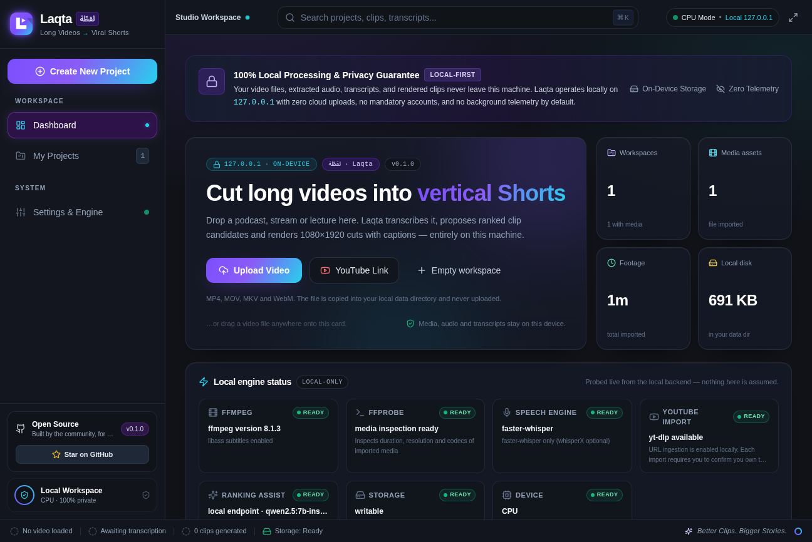

<div align="center">


### **The Free, Open-Source & Local-First Opus Clip Alternative**
**Turn long videos & podcasts into ranked vertical Shorts — entirely on your own machine.**

[](README.ar.md)
[](https://circleci.com/gh/thewizard2030/laqta)
[](https://github.com/thewizard2030/laqta/releases/latest)
[](https://github.com/thewizard2030/laqta/stargazers)
[](LICENSE)
[]()
[](docs/POLICY.md)
[](README.ar.md)

[English](README.md) • [العربية (Arabic)](README.ar.md)

</div>

---

Laqta (**لقطّة** — *"a take / a cut"*) imports long-form videos or podcasts, transcribes them locally with Faster-Whisper, ranks the most engaging clip candidates with an **explainable score**, and renders vertical 1080×1920 MP4s with right-to-left-aware captions.

**No account. No upload. No telemetry.** Media and audio processing stay strictly inside your machine (`127.0.0.1`). Zero mandatory paid API keys or cloud lock-in.


---

## ⚖️ Why Laqta vs. Commercial Tools

| Feature | **Laqta (Open Source)** | **Opus Clip / Submagic / Klap** | Generic OSS Tools |
| :--- | :--- | :--- | :--- |
| **Cost** | **100% Free (MIT License)** | \$19 – \$49 / month | Free |
| **Privacy & Security** | **100% Local** (Media never leaves PC) | Cloud uploaded & stored | Varies |
| **Arabic & RTL Support** | **Native RTL** + Arablish Whisper prompt | Frequently broken / reversed letters | Poor or unsupported |
| **Clip Scoring** | **Explainable** (Signal-by-signal rationale) | Black-box "viral %" | Arbitrary time cuts |
| **Hardware Fit** | Optimized for **8 GB RAM CPU** | Cloud servers only | Heavy GPU required |
| **Telemetry / Tracking** | **Zero** (Binds strictly to `127.0.0.1`) | User & footage tracked | Varies |
| **Extensibility** | CLI, local API, & manifest pipeline | Closed web app | Mostly CLI only |

---

## ✨ Key Features

| | |
|---|---|
| 🧠 **Explainable ranking** | Every clip carries a Clip Potential Score (0–100) **and the per-signal rationale that produced it** (speech rate, pitch dynamics, topic boundaries). No black-box fake virality scores — the ranking is [measured and benchmarked](docs/EVALUATION.md). |
| 🌍 **Arabic-First UX** | Native Right-to-Left (RTL) caption layout, FSI/PDI isolate markers, mirrored lines, and an Arabic-aware Whisper prompt that keeps English technical terms in Latin script without breaking layout. |
| 🔒 **Local-first guarantee** | Media, audio, transcripts, and rendered clips stay in your data directory. The local API binds to `127.0.0.1`; there is no telemetry. |
| 🪶 **Runs on modest hardware** | CPU-first and tuned for an 8 GB machine: a fast full pass for the transcript, then word-level re-timing only for the clips you actually render. |
| 🚪 **No subscription lock-in** | Works with zero API keys. Hosted providers (OpenRouter, Groq, Mistral, Cerebras, DeepSeek, Anthropic, Hugging Face) are optional, opt-in **and** fail-closed. |
| 🔑 **BYOK & Settings Studio** | Full Bring Your Own Keys studio with masked secret management, real provider connection verification, and hardware audit controls. |
| 💻 **Complete Studio UI** | Modern React + Vite workbench with interactive waveform, drag-and-drop import, timeline scrubbing, and title-safe vertical framing. |

---

## ⚙️ Bring Your Own Keys (BYOK) & Advanced Settings Studio

Introduced in **v0.2.0**, Laqta features a centralized 5-tab Settings Studio that configures the engine without editing configuration files or touching source code:

| Tab | Purpose & Capabilities |
| :--- | :--- |
| **AI Providers** | Manage API credentials for OpenRouter, Groq, Mistral, Cerebras, DeepSeek, Anthropic, and Hugging Face. Test connections live with instant latency and status feedback. |
| **Speech Recognition** | Select local Faster-Whisper models (e.g. `tiny`, `base`, `small`, `turbo`), configure Groq cloud fallback, tune beam size, and customize Arablish prompt behavior. |
| **Ingestion & Policy** | Explicitly control cloud API permissions (`allow_cloud_apis`) and URL ingestion gates (`enable_url_ingestion`). Rights confirmation remains mandatory per import. |
| **Storage & Cache** | View and configure data directory paths, manage transcript caches, clear temporary audio buffers, or trigger factory resets with safe confirmation gates. |
| **System Audit** | Live diagnostics of host hardware (CPU cores, RAM capacity, GPU availability), media tool dependencies (`ffmpeg`, `libass`), and environment configuration. |

### 🔒 Credential Storage & Security Architecture

Laqta treats API keys with defense-in-depth:
- **Local Isolation Only:** API keys and user preferences persist exclusively in the local SQLite database (`~/.local/share/qatta/qatta.db`) and an atomic JSON file mirror (`settings.json`).
- **Strict POSIX Permissions:** Directory paths enforce `0700` and file descriptors enforce `0600` (`-rw-------`), preventing read access by other local system users.
- **Masked Previews & API Redaction:** Keys are never transmitted in plaintext over API responses; secrets are always returned as masked previews (e.g. `sk-or-...a1b2`). Submitting a masked placeholder preserves the existing key without overwriting it.
- **SSRF Protection:** Connection verification probes reject private, loopback, and cloud metadata IP ranges (`169.254.169.254`, `metadata.google.internal`) and enforce `follow_redirects=False`.
- **Transparency Notice:** Secrets are stored **unencrypted at rest** within the permissions-protected local database files. Security is enforced via POSIX filesystem permission boundaries on the host machine.

---

## 📸 The Studio Workbench

<div align="center">


*The multi-track timeline, vertical 9:16 Shorts canvas player, and explainable clip candidate review.*

<br/>



*The home dashboard, system capabilities probe, and recent project management workspace.*

</div>

*Every screenshot in this repository was taken from a real, local run on a synthetic demo video — no third-party content.*

---

## 🚀 Quick Start

### Option 1: One-Line Docker Run (Recommended)

Run Laqta instantly without manually installing Python, Node, or FFmpeg:

```bash
git clone https://github.com/thewizard2030/laqta.git
cd laqta
docker compose up
```

Open your browser at **<http://localhost:8000>**.

---

### Option 2: Native Local Installation

#### Prerequisites
| Dependency | Version |
|---|---|
| **Python** | 3.11 or 3.12 |
| **Node.js** | 22.12 or newer |
| **FFmpeg** | with **libass** (for burned-in subtitles) |
| **Memory / RAM** | 8 GB works; a GPU is optional |

#### Setup & Launch

```bash
# 1. Clone repository
git clone https://github.com/thewizard2030/laqta.git
cd laqta

# 2. Setup backend & frontend
./scripts/setup.sh

# 3. Launch studio in release mode
laqta studio --production
```

The studio will build and serve from <http://127.0.0.1:8000>.

For active development with hot reload, use `./scripts/dev.sh` (API on `:8000` and Vite on `:5173`).

---

### Platform Notes

<details>
<summary><b>macOS (Homebrew)</b></summary>

```bash
brew install ffmpeg          # includes libass
./scripts/setup.sh
```

</details>

<details>
<summary><b>Windows (PowerShell)</b></summary>

```powershell
winget install Gyan.FFmpeg
powershell -ExecutionPolicy Bypass -File scripts\setup.ps1
```

</details>

<details>
<summary><b>Linux (Ubuntu / Debian / Fedora)</b></summary>

```bash
# Ubuntu / Debian
sudo apt update && sudo apt install -y ffmpeg libass-dev python3 python3-venv nodejs npm

# Fedora / RHEL
sudo dnf install -y ffmpeg libass python3 python3-devel nodejs npm
```

</details>

---

## 🩺 Check Your Machine (`laqta doctor`)

Laqta includes a built-in doctor command to verify installed dependencies:

```bash
laqta doctor
```

```text
✓   Python          3.11.x           >= 3.11 required
✓   FFmpeg          8.x              /usr/bin/ffmpeg (libass supported)
✓   FFprobe         8.x              /usr/bin/ffprobe
✓   Local ASR       faster-whisper   Speech recognition on this CPU
✓   Data directory  writable         ~/.local/share/qatta
```

> **First run model download:** The local speech model is downloaded once into your cache (~145 MB for `fast`, ~460 MB for `balanced`, ~1.5 GB for `accurate`). After that, everything runs 100% offline.

---

## 🌍 The Arabic & RTL Superpower

Most existing subtitle and short-form video editors break when handling Arabic:
- Letters get reversed or disconnected.
- Punctuation and brackets appear at the opposite side of the line.
- Mixed Arablish sentences (e.g. *"الـ AI بيشتغل على الـ CPU"*) cause words to jump positions.

Laqta solves this natively:
1. **FSI / PDI isolates & RLM markers** ensure correct directional boundaries between Arabic and Latin scripts.
2. **Specialized Arablish Whisper prompting** ensures technical terms (e.g. *Machine Learning*, *API*, *Docker*) remain in Latin script while the Arabic stays correctly shaped.
3. **Noto Sans Arabic** ensures high-contrast, modern subtitles rendered cleanly via `libass`.

---

## 📊 Measured Ranking Evaluation

```bash
python scripts/evaluate_ranking.py
```

```text
item              sel  hits    prec     rec      F1     cov     bad
-------------------------------------------------------------------
synthetic_01        6     3    1.00    1.00    1.00    0.95    0.00
synthetic_02        6     2    0.83    1.00    0.91    0.96    0.22
-------------------------------------------------------------------
TOTAL                          0.92    1.00    0.96    0.96    0.11
```

The benchmark synthesises its own narration, labels it by hand, and runs the real pipeline over it — so labeled spans are exact and scores are reproducible. Read the full methodology in [docs/EVALUATION.md](docs/EVALUATION.md).

---

## 🏗️ Architecture & Subsystems

```text
qatta/                     # Manifest-based core pipeline (Pydantic v2) & CLI
backend/                   # Local FastAPI service (binds strictly to 127.0.0.1) & SQLite
frontend/                  # React 19 + TypeScript + Vite studio workbench
scripts/                   # Developer tooling, CI checks, and lifecycle automation
docs/                      # Architecture, evaluation, brand system, PRD
tests/                     # Test suite (core pipeline, backend routes, unit tests)
```

### Subdirectories & System Boundaries

- **[Qatta Core Engine](./qatta/README.md)**: Manifest-based pipeline substrate (`qatta/core/schema.py`, `qatta/core/pipeline.py`) providing Pydantic v2 state serialization to `qatta_manifest.json`, pause-bounded utterance segmentation, stage timing tracking, and modular processing stages (`s01_ingest` through `s07_render_learn`).
- **[Laqta Backend](./backend/README.md)**: Local FastAPI web service (`backend/app/main.py`) binding exclusively to `127.0.0.1:8000`, SQLite repository layer (`qatta.db`), single-worker background job manager, media probing, transcription adapters, and vertical rendering pipelines.
- **[Laqta Frontend](./frontend/README.md)**: Local-first React 19 + TypeScript + Vite studio workbench (`frontend/src/App.tsx`) with vertical canvas preview, interactive multi-track timeline, AI-suggested candidate clips with explainable CPS scoring, ASS caption styling, and multi-tab BYOK settings.
- **[Scripts](./scripts/README.md)**: Repository lifecycle automation, local CI verification (`check.sh`), dual-process development launcher (`dev.sh`), environment bootstrap (`setup.sh`), and ranking benchmark suites (`evaluate_ranking.py`).

### Global Invariants

- **Local-first guarantee**: All media, transcripts, project metadata, and render outputs stay strictly on the local machine (`127.0.0.1`); zero telemetry, no accounts, and no mandatory cloud keys.
- **Fail-closed cloud gates**: All hosted cloud APIs (Groq, OpenRouter, AssemblyAI, Gemini) and URL ingestion (yt-dlp) require explicit operator opt-in (`allow_cloud_apis=true`, `enable_url_ingestion=true`).
- **Subprocess security**: All media operations (FFmpeg, FFprobe, yt-dlp) invoke system binaries via explicit argument arrays without `shell=True`, finite deadlines, and bounded memory buffers.
- **No LLM timestamps**: Transcripts are segmented into `AtomicUtterance` objects bounded by real acoustic pauses (`U_0001`); LLMs only receive and return `u_id` identifiers, never raw timestamps.
- **Arabic & BiDi correctness**: Subtitles remain in logical order with FSI/PDI directional isolates and RLM marks; BiDi text shaping is delegated to HarfBuzz/FriBiDi in libass.

### Global Side Effects

- **Local SQLite Database**: Persists and queries project workspaces, media assets, transcripts, candidate clips, background jobs, and user BYOK settings in `~/.local/share/qatta/qatta.db`.
- **Filesystem Storage**: Creates 16 kHz mono WAVs, JPEG preview thumbnails, ASS/SRT subtitles, and rendered vertical MP4 videos in local project folders under `~/.local/share/qatta/`.
- **System Subprocesses**: Spawns local FFmpeg and FFprobe worker processes for media inspection, audio extraction, and video encoding.
- **Loopback Ports**: Binds local TCP ports `127.0.0.1:8000` (FastAPI backend) and `127.0.0.1:5173` (Vite studio frontend).

### System Verification

- Run: `./scripts/check.sh --fast` (or `pytest && npm --prefix frontend test`)

---

| Reference Document | What it covers |
|---|---|
| [docs/ARCHITECTURE.md](docs/ARCHITECTURE.md) | How stages fit together, the manifest lifecycle, pipeline internals |
| [docs/EVALUATION.md](docs/EVALUATION.md) | Measured ranking benchmarks: precision, recall, F1, coverage |
| [docs/POLICY.md](docs/POLICY.md) | What leaves your machine, URL ingestion rights, model licenses |
| [docs/BRANDING.md](docs/BRANDING.md) | Name, colors, one-accent rule, typography system |
| [docs/PERFORMANCE.md](docs/PERFORMANCE.md) | Two-pass transcription profiles and memory benchmarks |
| [CONTRIBUTING.md](CONTRIBUTING.md) | Development setup, code guidelines, PR requirements |

---

## 📈 Star History

[](https://star-history.com/#thewizard2030/laqta&Date)

---

## 🤝 Contributing & Community

We welcome contributions from developers, designers, and video creators!

- Join the conversation on **[GitHub Discussions](https://github.com/thewizard2030/laqta/discussions)**.
- Report bugs or request features via **[GitHub Issues](https://github.com/thewizard2030/laqta/issues)**.
- Read our **[CONTRIBUTING.md](CONTRIBUTING.md)** and **[CODE_OF_CONDUCT.md](CODE_OF_CONDUCT.md)**.
- Security vulnerabilities should be reported privately according to **[SECURITY.md](SECURITY.md)**.

---

## 📄 License

[MIT](LICENSE) — © 2026 Mohamed Aboelela and Laqta contributors.

Third-party licenses are listed in [THIRD_PARTY_NOTICES.md](THIRD_PARTY_NOTICES.md). Laqta ships **no** proprietary weights; models are fetched on first use into your local Hugging Face cache.
