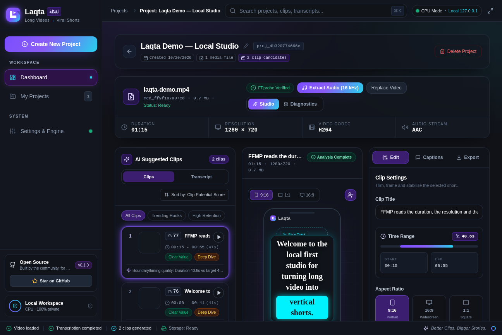
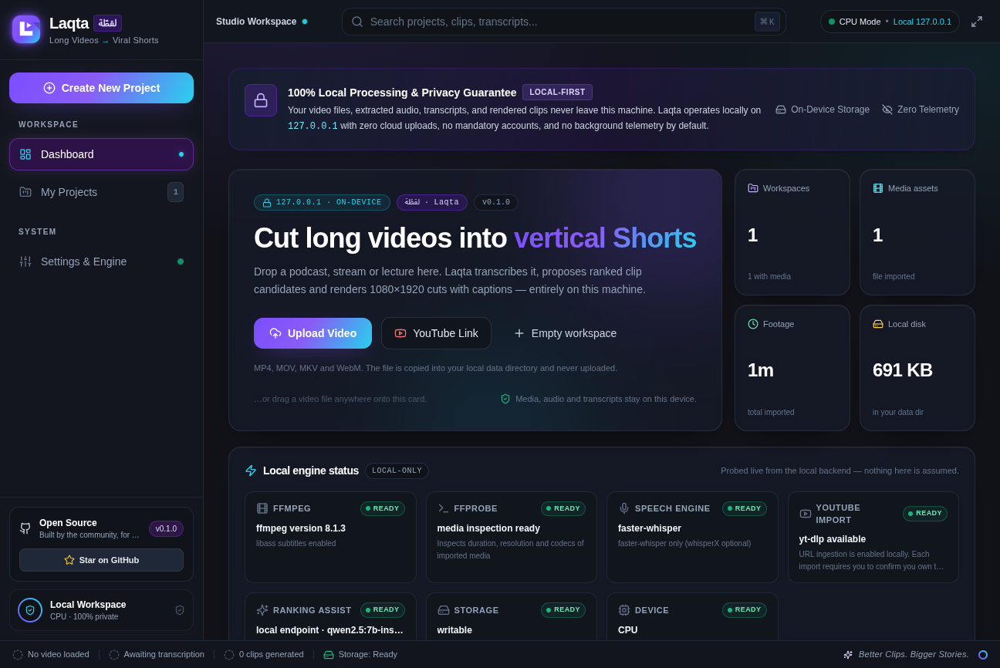
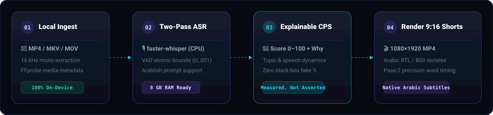
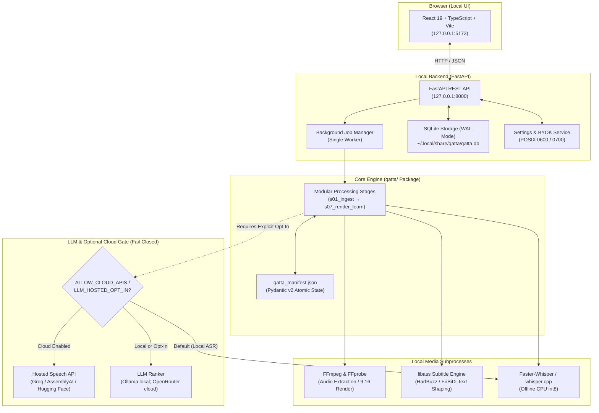

<div align="center">


# Laqta (لقطة)

### _Long Videos to Viral Shorts_

**An open-source, local-first AI-assisted video repurposing studio that helps creators discover, edit, and export vertical short-form clips from long videos.**

[](https://dl.circleci.com/status-badge/redirect/gh/thewizard2030/laqta/tree/main)
[](https://github.com/thewizard2030/laqta/releases/latest)
[](LICENSE)
[](docs/POLICY.md)
[](README.ar.md)

[English](README.md) • [العربية](README.ar.md)

[Overview](#-overview) • [Showcase](#-visual-showcase) • [Features](#-product-feature-matrix-v025) • [Privacy](#-honest-privacy--security-policy) • [Quick Start](#-quick-start) • [CLI](#-cli-reference) • [Architecture](#-system-architecture) • [Docs](#-documentation-center)

</div>

---

## 💡 Overview

Laqta (**لقطة** — _"a take, a shot, or a cut"_) is a desktop-grade, privacy-respecting studio that transforms long-form videos, interviews, and podcasts into engaging 9:16 vertical Shorts, Reels, and TikTok clips.

Most video repurposing tools require uploading gigabytes of private footage to proprietary cloud servers, lock essential features behind recurring monthly fees, or produce broken, reversed Arabic subtitles. Laqta changes this:

1. **Local-First by Default:** All media processing, audio extraction, transcription, and video rendering run directly on your own hardware (`127.0.0.1`). No cloud upload is ever required.
2. **CPU-First Architecture:** Engineered for standard 8 GB RAM machines using Faster-Whisper (`base` `int8` by default in the Studio backend; `qatta/` core pipeline also configures `QATTA_TURBO_MODEL` when memory allows) without requiring dedicated GPUs.
3. **Explainable Clip Potential Score (CPS):** Instead of arbitrary "viral prediction" percentages, Laqta evaluates candidate moments using measurable acoustic, linguistic, and pacing heuristics with full rationale transparency.
4. **First-Class Arabic & BiDi Support:** Native right-to-left (RTL) subtitle rendering with Unicode directional isolates (FSI/PDI) and Arablish Whisper prompts, keeping English technical terms in Latin script without breaking subtitle alignment.
5. **Bring Your Own Keys (BYOK):** Seamless support for local OpenAI-compatible endpoints (Ollama, LM Studio, llama.cpp, vLLM) and optional fail-closed hosted inference providers (OpenRouter for LLM ranking; Groq, AssemblyAI, Hugging Face for hosted ASR) with POSIX-isolated local credential storage.

---

## 📸 Visual Showcase

<div align="center">

### Studio Workbench


_Interactive multi-track timeline, vertical 9:16 Shorts player with title-safe area guides, karaoke subtitle editor, and explainable clip candidate selection._

<br/>

### Home Dashboard & Capabilities Monitor


_Project manager, local media import workspace, system hardware detection, and real-time processing status._

</div>

---

## 🔄 How It Works

Laqta processes videos through an atomic, resumable manifest pipeline (`qatta_manifest.json`):



1. **Local Ingestion:** Copies video footage safely into your local project workspace (`~/.local/share/qatta`). Original files are never modified.
2. **Audio Extraction:** High-speed 16 kHz mono WAV extraction via local FFmpeg subprocesses.
3. **Two-Pass Speech Recognition:**
   - **Pass A (Full Media):** Fast segment-level transcription via local Faster-Whisper (or optional opt-in cloud ASR / YouTube caption-first ingestion) without full-video word timestamps to conserve CPU cycles.
   - **Pass B (Selected Clips):** Clip-scoped word-level alignment (`small` `int8` model by default) computed on demand only for chosen clips when rendering karaoke captions.
4. **Heuristic Candidate Ranking:** Evaluates speech cadence, pause boundaries, and vocal dynamics to assign each segment an explainable **Clip Potential Score (CPS)**.
5. **9:16 Vertical Framing:** Reformats horizontal footage to 1080×1920 via `center_crop`, `blurred_background` or `face_guided` layouts with mobile title-safe area overlays in the Studio renderer. Core stage `qatta/stages/s06_reframe_subs` runs in the pipeline; when you opt in with `QATTA_FACE_GUIDED_FRAMING=true` (or `{"face_guided_framing": true}` on a pipeline job) it samples frames and solves a per-shot crop trajectory. With the `face_guided` layout the renderer pans the 9:16 window along that trajectory. Clips with no solved trajectory — including every clip when you have not opted in — render as a centred crop, and the render config records why.
6. **RTL-Compliant Subtitle Burn-In:** Renders animated karaoke-style captions via `libass` with HarfBuzz/FriBiDi text shaping.

---

## ⚖️ What Makes Laqta Different

| Dimension                  | Laqta (Open Source)                                             | Commercial SaaS Tools                                               | Generic Open-Source Scripts                    |
| :------------------------- | :-------------------------------------------------------------- | :------------------------------------------------------------------ | :--------------------------------------------- |
| **Data Privacy**           | **100% Local by Default**; media never leaves your device       | Mandatory video upload to third-party cloud servers                 | Varies; often requires cloud API keys          |
| **Software License**       | **MIT License**; completely free and open source                | \$19 to \$49+ recurring monthly subscription                        | Often GPL/AGPL with restrictive terms          |
| **Arabic & RTL Subtitles** | **Native BiDi & FSI/PDI isolates**; mixed Arablish preservation | Frequently reversed letters, detached glyphs, or broken punctuation | Basic SRT without complex script shaping       |
| **Clip Scoring**           | **Explainable CPS (0–100)** with signal-by-signal rationale     | Black-box "viral score" percentage without technical explanation    | Fixed arbitrary time cuts (e.g. 30s intervals) |
| **Hardware Baseline**      | **CPU-First (8 GB RAM)**; GPU acceleration optional             | Cloud servers only                                                  | Heavy CUDA/VRAM requirements (12 GB+ VRAM)     |
| **User Control**           | **BYOK Studio** with local key storage and live health probes   | Proprietary vendor lock-in                                          | Hardcoded environment variables                |
| **Telemetry & Tracking**   | **Zero Telemetry**; binds strictly to `127.0.0.1`               | Behavioral tracking and analytics                                   | Varies                                         |

> **Note on Clip Potential Score (CPS):** CPS is an editorial quality heuristic based on acoustic variation, speech rate, and semantic completeness. It is designed to surface compelling video segments for human editors, not to guarantee viral views or social media engagement.

---

## 🧩 Product Feature Matrix (v0.4.0)

### 🎬 Video Workflow & Editing

- **Local Import:** Drag-and-drop video upload supporting MP4, MOV, MKV, and WebM. `[Supported]`
- **Project Workspaces:** Persistent SQLite-backed project management in `~/.local/share/qatta/`. `[Supported]`
- **Multi-Track Timeline:** Interactive audio waveform scrubbing, playback controls, and clip trimming. `[Supported]`
- **Vertical Framing (9:16):** 1080×1920 `center_crop`, `blurred_background` or `face_guided` framing with safe-area overlays in Studio (`[Supported]`). `face_guided` follows a solved crop trajectory, which requires the opt-in solver (`QATTA_FACE_GUIDED_FRAMING=true` or the pipeline job flag) and sees frontal faces only (`[Opt-In]`). Without a trajectory the renderer centres the crop and records the fallback reason in the render config.
- **High-Quality Export:** Local FFmpeg encoding with burned-in ASS subtitles or standalone SRT export. `[Supported]`
- **URL Ingestion:** Optional YouTube caption-first importing via `yt-dlp` (fail-closed, requires operator enablement and per-import rights confirmation). `[Optional / Opt-In]`

### 🎙️ AI & Speech Recognition

- **Local Faster-Whisper:** CPU-optimized CTranslate2 speech recognition running 100% offline. `[Supported]`
- **Three Performance Profiles:**
  - `fast` (default): `base` model, `int8` quantization, beam size 1 (segment-level full pass; Pass B clip alignment on demand). Best for 8 GB RAM.
  - `balanced`: `small` model, `int8` quantization, beam size 1. Enhanced Arabic transcription accuracy (~2× decode cost vs `base`).
  - `accurate`: `medium` model, `int8` quantization, beam size 1, with full-video word alignment (noticeably slower on CPU).
- **Bilingual Arablish Prompting:** Pre-configured Whisper initial prompts that prevent English technical vocabulary from corrupting Arabic sentence flow. `[Supported]`
- **Optional Local / Hosted ASR:** Optional local `whisper.cpp` support `[Optional Local]`, plus fail-closed hosted transcription via Groq Cloud Whisper API, AssemblyAI API, or Hugging Face Inference API `[Optional / Opt-In]`.
- **OpenAI-Compatible & Hosted LLMs:** Integration with local inference servers (Ollama, LM Studio, llama.cpp, vLLM) or hosted OpenRouter (`LLM_HOSTED_OPT_IN=true`) for candidate evaluation. `[Optional / Opt-In]`

### 🔐 Privacy, Security & BYOK

- **Local-First Guarantee:** Zero background telemetry, analytics, or phone-home requests. `[Supported]`
- **Bring Your Own Keys (BYOK):** Dedicated 5-tab settings studio for credential configuration. `[Supported]`
- **Filesystem Permission Boundary:** Database directory enforces POSIX `0700` and files enforce `0600` (`-rw-------`). `[Supported]`
- **API Secret Redaction:** Keys are masked across API responses (e.g. `sk-or-...a1b2`); plain secrets are never returned to clients or written to application logs. `[Supported]`
- **SSRF Defense:** Connection probes block private IP ranges, link-local addresses, and cloud metadata endpoints (`169.254.169.254`, `metadata.google.internal`). `[Supported]`

### 🐧 Linux & Desktop Integration

- **Fedora/Linux Primary Support:** Tested on modern Fedora and Linux distributions. `[Supported]`
- **System Doctor CLI (`laqta doctor`):** Built-in diagnostic tool checking Python, FFmpeg, FFprobe, and disk permissions. `[Supported]`
- **XDG Desktop Launcher:** Desktop entry (`packaging/laqta.desktop`) and hicolor icons installed via `./packaging/install.sh --user`. `[Supported]`

---

## 🔒 Honest Privacy & Security Policy

> **Core Commitment:** Laqta is local-first by default. Local media processing and transcription stay on your device. Optional hosted providers can receive the specific transcript or audio data required for an operation only when the corresponding cloud permissions and user opt-in are enabled.

To review our complete privacy and security contracts:

- [docs/POLICY.md](docs/POLICY.md) — What leaves your machine, when it leaves, and rights responsibilities.
- [docs/BYOK_DESIGN.md](docs/BYOK_DESIGN.md) — BYOK credential architecture and threat model.
- [SECURITY.md](SECURITY.md) — Vulnerability reporting and private security disclosure process.

### Transparent Credential Storage Disclosure

In v0.2.5, user-configured API keys are stored locally in SQLite (`~/.local/share/qatta/qatta.db`) and an atomic file mirror (`settings.json`). **Secrets are stored unencrypted at rest** on your local drive and are protected strictly by operating system user permission boundaries (`0600` for files, `0700` for directories). If you share a physical machine account with other users, avoid storing sensitive production API keys.

---

## 🚀 Quick Start

### System Requirements

| Component   | Minimum / Baseline                                                           |
| :---------- | :--------------------------------------------------------------------------- |
| **OS**      | Linux (Fedora / RHEL or Ubuntu / Debian)                                     |
| **Python**  | `>= 3.11` (`3.11` or `3.12` recommended)                                     |
| **Node.js** | `>= 22.12` + `npm` (required by `frontend/package.json` for Vite 8 / Vitest) |
| **Media**   | `ffmpeg` (built with `libass` / HarfBuzz / FriBiDi) and `ffprobe`            |
| **Memory**  | 8 GB RAM (CPU-first `int8`; Whisper weights download on first transcription) |

### Method 1: Native Installation (Fedora / Linux Recommended)

#### 1. Install System Dependencies

**Fedora / RHEL:**

```bash
sudo dnf install -y ffmpeg libass python3 python3-devel nodejs npm
```

**Ubuntu / Debian:**

```bash
sudo apt update && sudo apt install -y ffmpeg libass-dev python3 python3-venv
```

> **Node.js `>= 22.12` on Ubuntu / Debian:** Standard distro `apt` repositories on older LTS releases often ship Node.js `< 20`. Install Node.js `22.x` via [nvm](https://github.com/nvm-sh/nvm), [fnm](https://github.com/Schniz/fnm), or NodeSource if `node -v` is below `v22.12`.

#### 2. Clone and Bootstrap

```bash
# Clone repository
git clone https://github.com/thewizard2030/laqta.git
cd laqta

# Create backend/.venv (core + API + local ASR) and install frontend dependencies
./scripts/setup.sh
# Optional flags: --all (adds yt-dlp + analysis extras) | --api-only | --no-frontend
```

#### 3. Verify Your System

Activate the created virtual environment (or invoke `./backend/.venv/bin/laqta` directly) and run `doctor`:

```bash
source backend/.venv/bin/activate
laqta doctor
```

```text
Laqta doctor — local environment check

✓   Python          3.11.x           >= 3.11 required
✓   FFmpeg          8.x              /usr/bin/ffmpeg
✓   FFprobe         8.x              /usr/bin/ffprobe
✓   Local ASR       faster-whisper   Speech recognition on this CPU
!   URL import      disabled by ...  Disabled by default (QATTA_ENABLE_URL_INGESTION=false)
✓   Data directory  writable         ~/.local/share/qatta
✓   Hosted ranker   disabled         Local heuristic scoring is used — nothing is uploaded
✓   Disk space      ...              available on the data volume
```

#### 4. Launch the Studio

For active development with hot-reloading:

```bash
./scripts/dev.sh
```

- **Backend API:** `http://127.0.0.1:8000` (Swagger docs at `/docs`)
- **Studio Workbench:** `http://127.0.0.1:5173`

For standalone local production mode (from an activated `backend/.venv`, builds and serves the frontend from FastAPI on a single address):

```bash
source backend/.venv/bin/activate
laqta studio --production
```

- Access the unified studio at `http://127.0.0.1:8000`.

Optional desktop menu integration on Linux:

```bash
./packaging/install.sh --user   # installs ~/.local/share/applications/laqta.desktop & icons
```

---

### Method 2: Docker Compose (Experimental Preview)

> [!NOTE]
> Native source installation (Method 1) is the primary verified path for `v0.4.0`. Review [Dockerfile](Dockerfile) and [docker-compose.yml](docker-compose.yml) carefully before containerized use (`Dockerfile` installs the core `.[asr]` extra rather than `backend/requirements.txt` and defines `QATTA_BIND_HOST`/`QATTA_BIND_PORT` rather than `QATTA_HOST`/`QATTA_PORT`).

```bash
git clone https://github.com/thewizard2030/laqta.git
cd laqta
docker compose up
```

When configured, open **`http://127.0.0.1:8000`**.

---

## ⌨️ CLI Reference

Run commands inside `source backend/.venv/bin/activate` (or prefix with `./backend/.venv/bin/`):

| Command                 | Description                                                                                     |
| :---------------------- | :---------------------------------------------------------------------------------------------- |
| `laqta --version`       | Print the installed Laqta version (`0.4.0`).                                                    |
| `laqta doctor [--json]` | Inspect Python, FFmpeg/FFprobe, ASR, URL gating, storage permissions, disk, and servers.        |
| `laqta run SOURCE`      | Run the full pipeline headless: `--project-id`, `--work-dir`, `--stages`, `--force`, `--json`.  |
| `laqta models`          | List locally cached Hugging Face speech models and disk usage.                                  |
| `laqta serve`           | Start the FastAPI backend (`--host 127.0.0.1 --port 8000 [--reload]`).                          |
| `laqta studio`          | Launch backend API + Vite UI (`--production`, `--api-only`, `--frontend-only`, `--skip-build`). |

---

## 🧪 Development & Verification

```bash
./scripts/check.sh --fast                 # Ruff, version sync, backend/core pytest, coverage check, TS/ESLint/Prettier/Vitest
pytest tests --tb=short                   # Core qatta/ test suite
cd backend && .venv/bin/pytest tests -n auto && cd ..   # FastAPI backend test suite
cd frontend && npm run check && cd ..     # Typecheck, ESLint, Prettier, Vitest
```

---

## 🛠️ Troubleshooting Common Issues

<details>
<summary><b>1. <code>laqta: command not found</code> or <code>No module named 'uvicorn'</code></b></summary>

`./scripts/setup.sh` installs `laqta` and backend dependencies inside `backend/.venv` rather than your global Python environment. Activate the virtual environment first (or run `./backend/.venv/bin/laqta`):

```bash
source backend/.venv/bin/activate
```

</details>

<details>
<summary><b>2. FFmpeg missing <code>libass</code> support</b></summary>

Burning captions directly into video requires FFmpeg built with `libass`. On Fedora, ensure you install `ffmpeg` and `libass` from standard or RPM Fusion repositories. Verify via:

```bash
ffmpeg -version | grep -- --enable-libass
```

</details>

<details>
<summary><b>3. Port 8000 or 5173 already in use</b></summary>

`QATTA_PORT` changes the **FastAPI backend** port in `./scripts/dev.sh` (`laqta doctor` also honors `QATTA_PORT`), whereas Vite's dev server stays on `127.0.0.1:5173` and proxies `/api` to `http://127.0.0.1:8000` (configured in `frontend/vite.config.ts`):

```bash
# Single-port production mode on an alternate port (no Vite dev server needed):
./backend/.venv/bin/laqta studio --production --port 8080

# Backend-only development on another port:
QATTA_PORT=8080 ./scripts/dev.sh
```

</details>

---

## 🏛️ System Architecture



### Subsystems Breakdown

- **`qatta/`**: Core manifest-based pipeline engine. Strictly modular, Pydantic v2 serialized, license-safe (MIT), and independent of web frameworks.
- **`backend/`**: Local FastAPI service (`backend/app/main.py`), SQLite repository, job manager, and settings API.
- **`frontend/`**: React 19 + Vite studio workbench, multi-track audio scrub bar, vertical 9:16 canvas, and settings tabs.
- **`scripts/`**: Development automation (`dev.sh`, `setup.sh`), CI testing gates, release validation/publishing (`publish_github_release.py`), and ranking benchmark harness.
- **`.circleci/`**: Primary automated CI (`ci` branch/PR workflow) and tag-triggered GitHub Release pipeline (`release` workflow with isolated `laqta-release-publishing` context); GitHub Actions workflows remain manual `workflow_dispatch` fallbacks/auxiliaries. Releases [`v0.2.5`](https://github.com/thewizard2030/laqta/releases/tag/v0.2.5), [`v0.3.0`](https://github.com/thewizard2030/laqta/releases/tag/v0.3.0) and [`v0.3.1`](https://github.com/thewizard2030/laqta/releases/tag/v0.3.1) passed CircleCI (`backend`, `frontend`, and `publish-release` in workflows [`1a3a76df`](https://app.circleci.com/workflow/1a3a76df-da76-472a-a5f4-8a5631483787), [`3d0f2617`](https://app.circleci.com/workflow/3d0f2617-08eb-499e-b906-36a6b9cee815) and [`913c44df`](https://app.circleci.com/workflow/913c44df-32db-42c4-9fac-a5e990a2df86)). [`v0.4.0`](https://github.com/thewizard2030/laqta/releases/tag/v0.4.0) is published, but its CircleCI `release` workflow is **red**: the `backend` job was killed mid-suite with no failing test and CircleCI rejected re-running it, so the asset was built from the immutable tag and verified independently — see [`docs/RELEASING.md`](docs/RELEASING.md).
- **`docs/`**: Technical documentation center, specifications, benchmarks, and policy manuals.

---

## 📚 Documentation Center

For comprehensive architectural specifications, benchmarks, and contributor guides, visit the **[Laqta Documentation Center](docs/README.md)**:

| Document                                                         | Description                                                                      |
| :--------------------------------------------------------------- | :------------------------------------------------------------------------------- |
| **[CHANGELOG.md](CHANGELOG.md)**                                 | Full release history including **`v0.2.5`**, fixes, and known limitations        |
| **[docs/RELEASING.md](docs/RELEASING.md)**                       | Automated CircleCI tag-release flow, SHA-256 verification, and completed release records |
| **[docs/CIRCLECI_MIGRATION.md](docs/CIRCLECI_MIGRATION.md)**     | CircleCI 2.1 Smarter Testing, `laqta-release-publishing`, and GHA deprecation    |
| **[docs/LICENSING.md](docs/LICENSING.md)**                       | Permanent MIT License policy, third-party separation, and trademark references   |
| **[docs/ARCHITECTURE.md](docs/ARCHITECTURE.md)**                 | Deep-dive into manifest lifecycle, stage synchronization, and IPC boundaries     |
| **[docs/POLICY.md](docs/POLICY.md)**                             | Public privacy contract, telemetry policy, and model license documentation       |
| **[docs/BYOK_DESIGN.md](docs/BYOK_DESIGN.md)**                   | Bring Your Own Keys specification, SQLite schema, and security threat model      |
| **[docs/EVALUATION.md](docs/EVALUATION.md)**                     | Measured clip-selection precision, recall, and F1 ranking benchmarks             |
| **[docs/PERFORMANCE.md](docs/PERFORMANCE.md)**                   | Two-pass transcription profiles and 8 GB RAM memory constraints                  |
| **[docs/CAPTION_QA.md](docs/CAPTION_QA.md)**                     | Arabic BiDi subtitle layout verification, FSI/PDI isolates, and `libass` burn-in |
| **[docs/UPGRADING.md](docs/UPGRADING.md)**                       | Release upgrade paths, database migrations, and configuration compatibility      |
| **[docs/BRANDING.md](docs/BRANDING.md)**                         | Official brand identity, color tokens, and asset usage guidelines                |
| **[THIRD_PARTY_NOTICES.md](THIRD_PARTY_NOTICES.md)**             | Open-source licenses and copyright attributions for direct and runtime packages  |
| **[docs/RELEASE_NOTES_v0.2.0.md](docs/RELEASE_NOTES_v0.2.0.md)** | Earlier `v0.2.0` release notes (BYOK & Advanced Settings Studio)                 |

---

## 🤝 Contributing

We welcome contributions from developers, designers, and video creators!

- **Report Bugs & Suggest Features:** Open an issue via **[GitHub Issues](https://github.com/thewizard2030/laqta/issues)**.
- **Contribution Guidelines:** Read **[CONTRIBUTING.md](CONTRIBUTING.md)** for development setup, test execution, and code style.
- **Community Standards:** Our community follows **[CODE_OF_CONDUCT.md](CODE_OF_CONDUCT.md)**.
- **Security Vulnerabilities:** Please report security issues privately via [GitHub Security Advisories](https://github.com/thewizard2030/laqta/security/advisories/new) or per instructions in **[SECURITY.md](SECURITY.md)**.

---

## 📈 Star History

[](https://star-history.com/#thewizard2030/laqta&Date)

---

## 📄 License

Laqta is open-source software licensed under the **[MIT License](LICENSE)**.
© 2026 Mohamed Aboelela and Laqta contributors.

Third-party dependencies and runtime component licenses are documented in [THIRD_PARTY_NOTICES.md](THIRD_PARTY_NOTICES.md).
