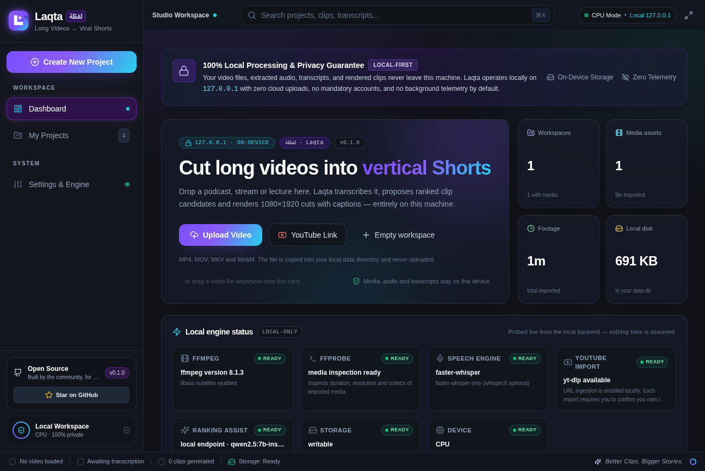
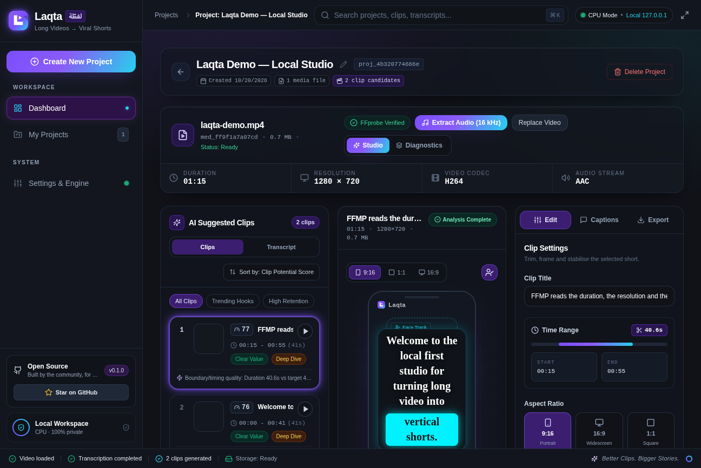

<div align="center">


**Turn long videos into ranked vertical Shorts — entirely on your own machine.**

[](https://github.com/thewizard2030/laqta/actions/workflows/ci.yml)
[](https://github.com/thewizard2030/laqta/releases/latest)
[](LICENSE)
[](https://www.python.org/)
[](https://nodejs.org/)
[](docs/POLICY.md)

</div>

---

Laqta imports a long video, transcribes it locally, ranks the most promising
clips with an **explainable** score, and renders vertical 1080×1920 MP4s with
right-to-left-aware captions.

**No account. No upload. No telemetry.** The only thing that ever leaves your
computer is a transcript snippet — and only if *you* configure a hosted
provider and consent to it.



---

## Why Laqta

| | |
|---|---|
| 🧠 **Explainable ranking** | Every clip carries a Clip Potential Score (0–100) **and the per-signal rationale that produced it**. No "viral score" from a black box. |
| 🔒 **Local by default** | Media, audio, transcripts and renders stay in your data directory. The API binds to `127.0.0.1`; there is no telemetry at all. |
| 🌍 **Arabic-first** | RTL caption layout, FSI/PDI isolates, mirrored lines, and an Arabic-aware Whisper prompt that keeps English terms in Latin script. |
| 🪶 **Modest hardware** | CPU-first and tuned for an 8 GB machine: a fast full pass for the transcript, then word-level re-timing only for the clips you actually render. |
| 🚪 **No lock-in** | Works with zero API keys. Hosted providers (OpenRouter, Groq, AssemblyAI) are optional, opt-in **and** fail-closed. |
| ⌨️ **Scriptable** | A `laqta` command line, a local API, and a manifest-based pipeline you can drive yourself. |

---

## What it does

```text
   import  ──▶  transcribe  ──▶  rank  ──▶  render
      │             │              │          │
   probe with    local ASR,     explainable  1080×1920
   FFprobe,      VAD-bounded     CPS 0–100   MP4 + burned-in
   copy into     utterances      with the    captions
   your data     (U_0001, …)     reasons
   directory
```



*Every screenshot in this README was taken from a real, local run on a
synthetic demo video — no third-party content.*

---

## Quick start

### Requirements

| | |
|---|---|
| Python | 3.11 or 3.12 |
| Node.js | 22.12 or newer (Vitest 5 requirement) |
| FFmpeg | with **libass** (for the burned-in captions) |
| Disk | ~2 GB free (the speech model is downloaded once) |
| RAM | 8 GB works; a GPU is optional |

### Install

```bash
git clone https://github.com/thewizard2030/laqta.git
cd laqta
./scripts/setup.sh
```

That creates the backend environment, installs the pinned dependencies and the
frontend, and registers the `laqta` command. Then — **one command, one
address**:

```bash
laqta studio --production
```

It builds the studio and serves the whole application from
<http://127.0.0.1:8000>. (For development with hot reload, use
`./scripts/dev.sh` instead: the API on `:8000` and the Vite dev server on
`:5173`.)

Check the machine at any time:

```bash
laqta doctor            # what is installed and what is running
laqta doctor --json     # the same facts, machine-readable
```

### Platform notes

<details>
<summary><b>macOS</b></summary>

```bash
brew install ffmpeg          # includes libass
./scripts/setup.sh
```

</details>

<details>
<summary><b>Windows (PowerShell)</b></summary>

```powershell
winget install Gyan.FFmpeg
# then, in the repository:
powershell -ExecutionPolicy Bypass -File scripts\setup.ps1
```

</details>

<details>
<summary><b>Fedora / RHEL</b></summary>

```bash
sudo dnf install ffmpeg libass python3 python3-devel nodejs npm
```

</details>

### Check your machine

```bash
backend/.venv/bin/laqta doctor
```

```
✓   Python          3.11.16           >= 3.11 required
✓   FFmpeg          8.1.3             /usr/bin/ffmpeg
✓   FFprobe         8.1.3             /usr/bin/ffprobe
✓   Local ASR       faster-whisper    Speech recognition on this CPU
✓   URL import      yt-dlp available  Enabled by the operator
✓   Data directory  writable          ~/.local/share/qatta
```

It reports exactly what is installed and what is missing — the same honest
capability probe the studio shows.

> **First run downloads a model.** The local speech model is fetched once into
> the Hugging Face cache: ~145 MB for the `fast` profile, ~460 MB for
> `balanced`, ~1.5 GB for `accurate`. After that, everything works offline.
> See [docs/RELEASING.md](docs/RELEASING.md#model-weights).

---

## The `laqta` command

```bash
laqta doctor                  # check this machine for everything Laqta needs
laqta doctor --json           # the same report, machine-readable
laqta serve                   # run the local API server (127.0.0.1)
laqta studio                  # run the API and the studio together
laqta studio --production      # build the studio, serve it from the API
laqta models                  # show the locally cached speech models
laqta --version
```

---

## Configuration

Copy the template and edit what you need:

```bash
cp .env.example .env
```

All settings use the `QATTA_` prefix and are **optional** — the defaults in
[`.env.example`](.env.example) are the ones the code uses. Every variable is
documented there, grouped by area, with the secrets commented out.

The hosted paths are **fail-closed**. `QATTA_ALLOW_CLOUD_APIS=false`,
`QATTA_LLM_HOSTED_OPT_IN=false` and a missing key all mean the deterministic
local ranker is used, and the interface says so.

---

## Architecture

```text
qatta/                     # the manifest-based core pipeline
  core/schema.py           # Pydantic v2 models, atomic per-project state
  core/pipeline.py         # stage orchestration, resume, timings
  stages/                  # s01_ingest → s02_transcript → s03_multimodal →
                           # s04_candidates → s05/s05b → s06_reframe_subs → s07_render
backend/                   # the FastAPI service (binds to 127.0.0.1)
  app/api/routes/          # /api/health, /api/capabilities, /api/projects, …
  app/services/            # media probing, transcription, captions, rendering
frontend/                  # React 18 + TypeScript + Vite + Tailwind
  src/features/dashboard/  # the home screen
  src/components/studio/   # clips, canvas, timeline, inspector
docs/                      # PRD, policy, performance, branding, releasing
tests/                     # the core pipeline test suite
```

The core is **web-framework free** and import-light: heavy libraries
(faster-whisper, librosa, scenedetect, mediapipe) are imported lazily inside
the stage that needs them, so a missing optional dependency degrades with a
clear error instead of a broken import.

| Document | What it covers |
|----------|----------------|
| [docs/ARCHITECTURE.md](docs/ARCHITECTURE.md) | How the pieces fit together, the manifest lifecycle, where to change things |
| [docs/UPGRADING.md](docs/UPGRADING.md) | What changed between the releases, and what you have to do |
| [docs/PRD.md](docs/PRD.md) | The product requirements the code implements |
| [docs/POLICY.md](docs/POLICY.md) | What leaves your machine, rights for URL imports, model licences |
| [docs/PERFORMANCE.md](docs/PERFORMANCE.md) | Profiles, two-pass transcription, benchmarks |
| [docs/TRANSCRIPTION_TRADEOFFS.md](docs/TRANSCRIPTION_TRADEOFFS.md) | CPU/RAM trade-offs and the alternatives |
| [docs/BRANDING.md](docs/BRANDING.md) | The name, the palette, the one-accent rule |
| [docs/RELEASING.md](docs/RELEASING.md) | Version bumps, tags, what CI checks |
| [SECURITY.md](SECURITY.md) | The threat model and how to report a problem |
| [CONTRIBUTING.md](CONTRIBUTING.md) | Setup, the rules that matter, the commands CI runs |

---

## Development

```bash
# Everything at once
./scripts/setup.sh && ./scripts/dev.sh

# The gates CI runs
cd backend && .venv/bin/pytest && pytest ../tests
cd ../frontend && npm run check
python scripts/check_version.py
```

| Suite | Count |
|-------|-------|
| Core pipeline (`tests/`) | 159 tests |
| Backend API (`backend/tests/`) | 274 tests |
| Frontend (Vitest) | 106 tests |

---

## Contributing

Issues and discussions are open: <https://github.com/thewizard2030/laqta>

- **Contributing:** [CONTRIBUTING.md](CONTRIBUTING.md)
- **Security:** [SECURITY.md](SECURITY.md) — report privately, please
- **Support:** [SUPPORT.md](SUPPORT.md)
- **Code of conduct:** [CODE_OF_CONDUCT.md](CODE_OF_CONDUCT.md)
- **Changelog:** [CHANGELOG.md](CHANGELOG.md)

---

## Roadmap

- [x] Foundation: honest capability probe, health checks, home screen, privacy copy
- [x] Project store: local import, media probing, SQLite models
- [x] Job queue: persistent single worker, safe 16 kHz extraction, restart recovery
- [x] Transcription: faster-whisper on CPU, two-pass word timing
- [x] Candidate scoring: explainable CPS with per-signal rationale
- [x] Rendering: 1080×1920 export with Arabic/English burned-in captions
- [ ] A public evaluation benchmark and dataset for the ranking signals

---

## License

[MIT](LICENSE) — © 2026 Mohamed Aboelela and Laqta contributors.

Third-party licences — including the model weights — are listed in
[THIRD_PARTY_NOTICES.md](THIRD_PARTY_NOTICES.md). Laqta ships **no** model
weights; the speech model is downloaded on first use.
