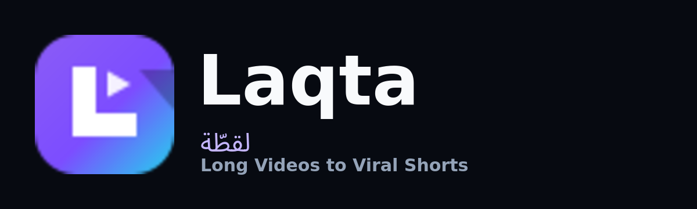
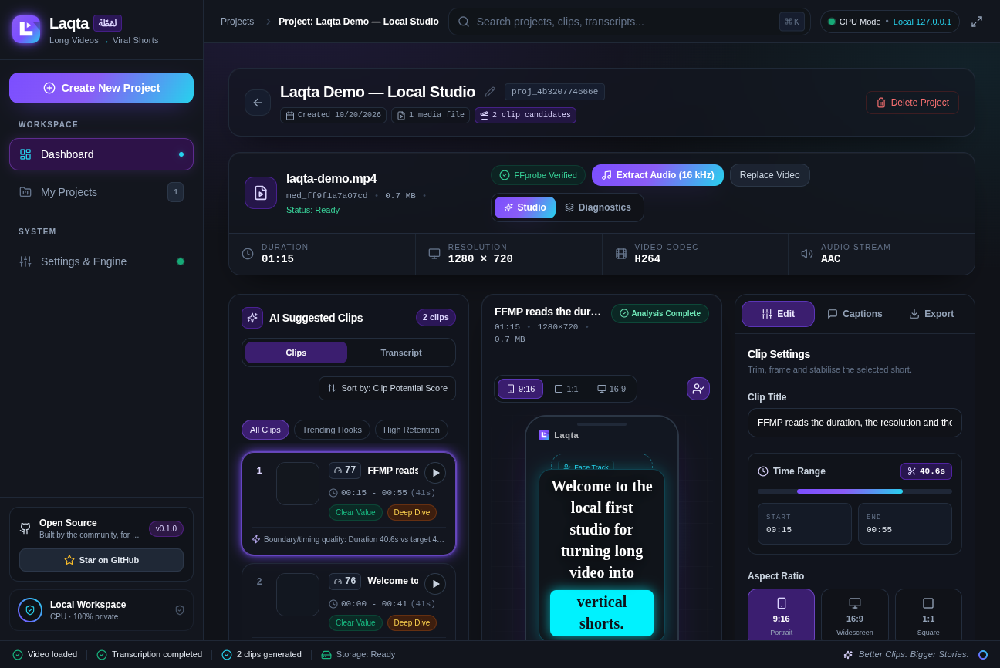
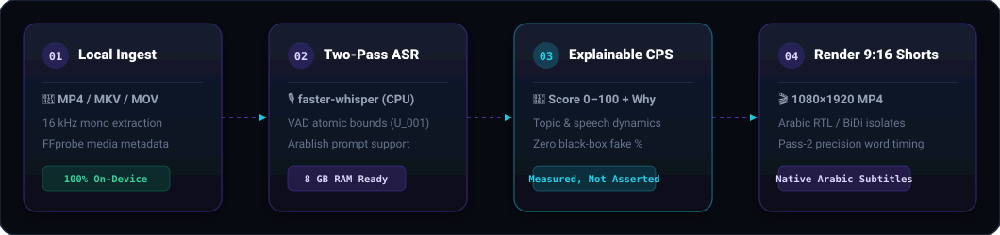
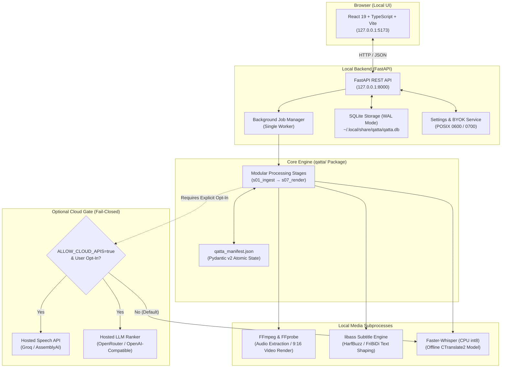

<div align="center">



# Laqta (لقطة)
### *Long Videos to Viral Shorts*

**An open-source, local-first AI-assisted video repurposing studio that helps creators discover, edit, and export vertical short-form clips from long videos.**

[](https://app.circleci.com/pipelines/github/thewizard2030/laqta)
[](https://github.com/thewizard2030/laqta/releases/latest)
[](LICENSE)
[](docs/POLICY.md)
[](README.ar.md)

[English](README.md) • [العربية](README.ar.md)

</div>

---

## 💡 Overview

Laqta (**لقطة** — *"a take, a shot, or a cut"*) is a desktop-grade, privacy-respecting studio that transforms long-form videos, interviews, and podcasts into engaging 9:16 vertical Shorts, Reels, and TikTok clips.

Most video repurposing tools require uploading gigabytes of private footage to proprietary cloud servers, lock essential features behind recurring monthly fees, or produce broken, reversed Arabic subtitles. Laqta changes this:

1. **Local-First by Default:** All media processing, audio extraction, transcription, and video rendering run directly on your own hardware (`127.0.0.1`). No cloud upload is ever required.
2. **CPU-First Architecture:** Engineered for standard 8 GB RAM machines using efficient Faster-Whisper models (`int8` quantization) without requiring expensive dedicated GPUs.
3. **Explainable Clip Potential Score (CPS):** Instead of arbitrary "viral prediction" percentages, Laqta evaluates candidate moments using measurable acoustic, linguistic, and pacing heuristics with full rationale transparency.
4. **First-Class Arabic & BiDi Support:** Native right-to-left (RTL) subtitle rendering with Unicode directional isolates (FSI/PDI) and Arablish Whisper prompts, keeping English technical terms in Latin script without breaking subtitle alignment.
5. **Bring Your Own Keys (BYOK):** Seamless support for optional cloud inference providers (OpenRouter, Groq, AssemblyAI, Hugging Face) and local OpenAI-compatible endpoints (Ollama, LM Studio) with strict local credential isolation.

---

## 📸 Visual Showcase

<div align="center">

### Studio Workbench

*Interactive multi-track timeline, vertical 9:16 Shorts player with title-safe area guides, karaoke subtitle editor, and explainable clip candidate selection.*

<br/>

### Home Dashboard & Capabilities Monitor

*Project manager, local media import workspace, system hardware detection, and real-time processing status.*

</div>

---

## 🔄 How It Works

Laqta processes videos through an atomic, resumable manifest pipeline (`qatta_manifest.json`):



1. **Local Ingestion:** Copies video footage safely into your local project workspace (`~/.local/share/qatta`). Original files are never modified.
2. **Audio Extraction:** High-speed 16 kHz mono WAV extraction via local FFmpeg subprocesses.
3. **Two-Pass Speech Recognition:**
   - **Pass A (Full Media):** Fast segment-level transcription via local Faster-Whisper (or optional Groq cloud fallback) without full-video word timestamps to conserve CPU cycles.
   - **Pass B (Selected Clips):** Precise word-level timing alignment computed only for the specific clips chosen for rendering.
4. **Heuristic Candidate Ranking:** Evaluates speech cadence, pitch dynamics, and topic boundaries to assign each segment an explainable **Clip Potential Score (CPS)**.
5. **Vertical Video Reframing:** Centers active speakers into a vertical 1080×1920 canvas with title-safe area margins for mobile platforms.
6. **RTL-Compliant Subtitle Burn-In:** Renders animated karaoke-style captions via `libass` with HarfBuzz/FriBiDi text shaping.

---

## ⚖️ What Makes Laqta Different

| Dimension | Laqta (Open Source) | Commercial SaaS Tools | Generic Open-Source Scripts |
| :--- | :--- | :--- | :--- |
| **Data Privacy** | **100% Local by Default**; media never leaves your device | Mandatory video upload to third-party cloud servers | Varies; often requires cloud API keys |
| **Software License** | **MIT License**; completely free and open source | \$19 to \$49+ recurring monthly subscription | Often GPL/AGPL with restrictive terms |
| **Arabic & RTL Subtitles** | **Native BiDi & FSI/PDI isolates**; mixed Arablish preservation | Frequently reversed letters, detached glyphs, or broken punctuation | Basic SRT without complex script shaping |
| **Clip Scoring** | **Explainable CPS (0–100)** with signal-by-signal rationale | Black-box "viral score" percentage without technical explanation | Fixed arbitrary time cuts (e.g. 30s intervals) |
| **Hardware Baseline** | **CPU-First (8 GB RAM)**; GPU acceleration optional | Cloud servers only | Heavy CUDA/VRAM requirements (12 GB+ VRAM) |
| **User Control** | **BYOK Studio** with local key storage and live health probes | Proprietary vendor lock-in | Hardcoded environment variables |
| **Telemetry & Tracking** | **Zero Telemetry**; binds strictly to `127.0.0.1` | Behavioral tracking and analytics | Varies |

> **Note on Clip Potential Score (CPS):** CPS is an editorial quality heuristic based on acoustic variation, speech rate, and semantic completeness. It is designed to surface compelling video segments for human editors, not to guarantee viral views or social media engagement.

---

## 🧩 Product Feature Matrix (v0.2.0)

### 🎬 Video Workflow & Editing
- **Local Import:** Drag-and-drop video upload supporting MP4, MOV, MKV, and WebM. `[Supported]`
- **Project Workspaces:** Persistent SQLite-backed project management in `~/.local/share/qatta/`. `[Supported]`
- **Multi-Track Timeline:** Interactive audio waveform scrubbing, playback controls, and clip trimming. `[Supported]`
- **Vertical Framing (9:16):** 1080×1920 portrait reframing with safe-area overlays for Shorts/Reels/TikTok. `[Supported]`
- **High-Quality Export:** Local FFmpeg encoding with burned-in ASS subtitles or standalone SRT export. `[Supported]`
- **URL Ingestion:** Optional YouTube caption-first importing via `yt-dlp` (fail-closed, requires operator enablement and per-import rights confirmation). `[Optional / Opt-In]`

### 🎙️ AI & Speech Recognition
- **Local Faster-Whisper:** CPU-optimized CTranslate2 speech recognition running 100% offline. `[Supported]`
- **Three Performance Profiles:**
  - `fast` (default): `base` model, `int8` quantization, beam size 1. Best for quick turnaround on 8 GB RAM.
  - `balanced`: `small` model, `int8` quantization. Enhanced Arabic transcription accuracy.
  - `accurate`: Configurable larger model with full-video word alignment.
- **Bilingual Arablish Prompting:** Pre-configured Whisper initial prompts that prevent English technical vocabulary from corrupting Arabic sentence flow. `[Supported]`
- **Optional Hosted ASR:** Fast cloud transcription fallback via Groq Cloud Whisper API or AssemblyAI API. `[Optional / Opt-In]`
- **OpenAI-Compatible LLMs:** Integration with local inference servers (Ollama, LM Studio) or hosted providers (OpenRouter) for candidate evaluation. `[Optional / Opt-In]`

### 🔐 Privacy, Security & BYOK
- **Local-First Guarantee:** Zero background telemetry, analytics, or phone-home requests. `[Supported]`
- **Bring Your Own Keys (BYOK):** Dedicated 5-tab settings studio for credential configuration. `[Supported]`
- **Filesystem Permission Boundary:** Database directory enforces POSIX `0700` and files enforce `0600` (`-rw-------`). `[Supported]`
- **API Secret Redaction:** Keys are masked across API responses (e.g. `sk-or-...a1b2`); plain secrets are never returned to clients or written to application logs. `[Supported]`
- **SSRF Defense:** Connection probes block private IP ranges, link-local addresses, and cloud metadata endpoints (`169.254.169.254`, `metadata.google.internal`). `[Supported]`

### 🐧 Linux & Desktop Integration
- **Fedora/Linux Primary Support:** Tested on modern Fedora and Linux distributions. `[Supported]`
- **System Doctor CLI (`laqta doctor`):** Built-in diagnostic tool checking Python, FFmpeg, FFprobe, and disk permissions. `[Supported]`
- **XDG Desktop Launcher:** Desktop entry (`laqta.desktop`) and scalable application icons for application menus. `[Supported]`

---

## 🔒 Honest Privacy & Security Policy

> **Core Commitment:** Laqta is local-first by default. Local media processing and transcription stay on your device. Optional hosted providers can receive the specific transcript or audio data required for an operation only when the corresponding cloud permissions and user opt-in are enabled.

To review our complete privacy and security contracts:
- [docs/POLICY.md](docs/POLICY.md) — What leaves your machine, when it leaves, and rights responsibilities.
- [docs/BYOK_DESIGN.md](docs/BYOK_DESIGN.md) — BYOK credential architecture and threat model.
- [SECURITY.md](SECURITY.md) — Vulnerability reporting and private security disclosure process.

### Transparent Credential Storage Disclosure
In v0.2.0, user-configured API keys are stored locally in SQLite (`~/.local/share/qatta/qatta.db`) and an atomic file mirror (`settings.json`). **Secrets are stored unencrypted at rest** on your local drive and are protected strictly by operating system user permission boundaries (`0600` for files, `0700` for directories). If you share a physical machine account with other users, avoid storing sensitive production API keys.

---

## 🚀 Quick Start

### Method 1: Native Installation (Fedora / Linux Recommended)

#### 1. Install System Dependencies

**Fedora / RHEL:**
```bash
sudo dnf install -y ffmpeg libass python3 python3-devel nodejs npm
```

**Ubuntu / Debian:**
```bash
sudo apt update && sudo apt install -y ffmpeg libass-dev python3 python3-venv nodejs npm
```

#### 2. Clone and Bootstrap

```bash
# Clone repository
git clone https://github.com/thewizard2030/laqta.git
cd laqta

# Run automated development bootstrap (installs Python venv + frontend packages)
./scripts/setup.sh
```

#### 3. Verify Your System

Run the built-in diagnostic doctor to ensure all media and speech dependencies are ready:

```bash
laqta doctor
```

```text
✓   Python          3.11.x           >= 3.11 required
✓   FFmpeg          8.x              /usr/bin/ffmpeg (libass supported)
✓   FFprobe         8.x              /usr/bin/ffprobe
✓   Local ASR       faster-whisper   Speech recognition on this CPU
✓   Data directory  writable         ~/.local/share/qatta
```

#### 4. Launch the Studio

For active development with hot-reloading:
```bash
./scripts/dev.sh
```
- **Backend API:** `http://127.0.0.1:8000`
- **Studio Workbench:** `http://127.0.0.1:5173`

For standalone local production mode:
```bash
laqta studio --production
```
- Access the unified studio at `http://127.0.0.1:8000`.

---

### Method 2: Containerized Run (Docker Compose)

Run Laqta instantly in an isolated Linux container with pre-packaged FFmpeg and libass:

```bash
git clone https://github.com/thewizard2030/laqta.git
cd laqta
docker compose up
```

Open your browser at **`http://localhost:8000`**.

---

## 🛠️ Troubleshooting Common Issues

<details>
<summary><b>1. <code>ModuleNotFoundError: No module named 'uvicorn'</code></b></summary>

Ensure you have run `./scripts/setup.sh` to initialize the Python virtual environment under `backend/.venv`. If running commands manually, activate the virtual environment first:
```bash
source backend/.venv/bin/activate
```
</details>

<details>
<summary><b>2. FFmpeg missing <code>libass</code> support</b></summary>

Burning captions directly into video requires FFmpeg built with `libass`. On Fedora, ensure you install `ffmpeg` and `libass` from standard or RPM Fusion repositories. Verify via:
```bash
ffmpeg -version | grep -- --enable-libass
```
</details>

<details>
<summary><b>3. Port 8000 or 5173 already in use</b></summary>

You can configure alternate port bindings by specifying environment variables before launching:
```bash
QATTA_PORT=8080 ./scripts/dev.sh
```
</details>

---

## 🏛️ System Architecture



### Subsystems Breakdown
- **`qatta/`**: Core manifest-based pipeline engine. Strictly modular, Pydantic v2 serialized, license-safe (MIT), and independent of web frameworks.
- **`backend/`**: Local FastAPI service (`backend/app/main.py`), SQLite repository, job manager, and settings API.
- **`frontend/`**: React 19 + Vite studio workbench, multi-track audio scrub bar, vertical 9:16 canvas, and settings tabs.
- **`scripts/`**: Development automation (`dev.sh`, `setup.sh`), CI testing gates, and ranking benchmark harness.
- **`docs/`**: Technical documentation center, specifications, benchmarks, and policy manuals.

---

## 📚 Documentation Center

For comprehensive architectural specifications, benchmarks, and contributor guides, visit the **[Laqta Documentation Center](docs/README.md)**:

| Document | Description |
| :--- | :--- |
| **[docs/ARCHITECTURE.md](docs/ARCHITECTURE.md)** | Deep-dive into manifest lifecycle, stage synchronization, and IPC boundaries |
| **[docs/POLICY.md](docs/POLICY.md)** | Public privacy contract, telemetry policy, and model license documentation |
| **[docs/BYOK_DESIGN.md](docs/BYOK_DESIGN.md)** | Bring Your Own Keys specification, SQLite schema, and security threat model |
| **[docs/EVALUATION.md](docs/EVALUATION.md)** | Measured clip-selection precision, recall, and F1 ranking benchmarks |
| **[docs/PERFORMANCE.md](docs/PERFORMANCE.md)** | Two-pass transcription profiles and 8 GB RAM memory constraints |
| **[docs/BRANDING.md](docs/BRANDING.md)** | Official brand identity, color tokens, and asset usage guidelines |
| **[docs/RELEASE_NOTES_v0.2.0.md](docs/RELEASE_NOTES_v0.2.0.md)** | Official v0.2.0 release notes and feature highlights |

---

## 🤝 Contributing

We welcome contributions from developers, designers, and video creators!

- **Report Bugs & Suggest Features:** Open an issue via **[GitHub Issues](https://github.com/thewizard2030/laqta/issues)**.
- **Contribution Guidelines:** Read **[CONTRIBUTING.md](CONTRIBUTING.md)** for development setup, test execution, and code style.
- **Community Standards:** Our community follows **[CODE_OF_CONDUCT.md](CODE_OF_CONDUCT.md)**.
- **Security Vulnerabilities:** Please report security issues privately via [GitHub Security Advisories](https://github.com/thewizard2030/laqta/security/advisories/new) or per instructions in **[SECURITY.md](SECURITY.md)**.

---

## 📈 Star History

[](https://star-history.com/#thewizard2030/laqta&Date)

---

## 📄 License

Laqta is open-source software licensed under the **[MIT License](LICENSE)**.
© 2026 Mohamed Aboelela and Laqta contributors.

Third-party dependencies and runtime component licenses are documented in [THIRD_PARTY_NOTICES.md](THIRD_PARTY_NOTICES.md).
